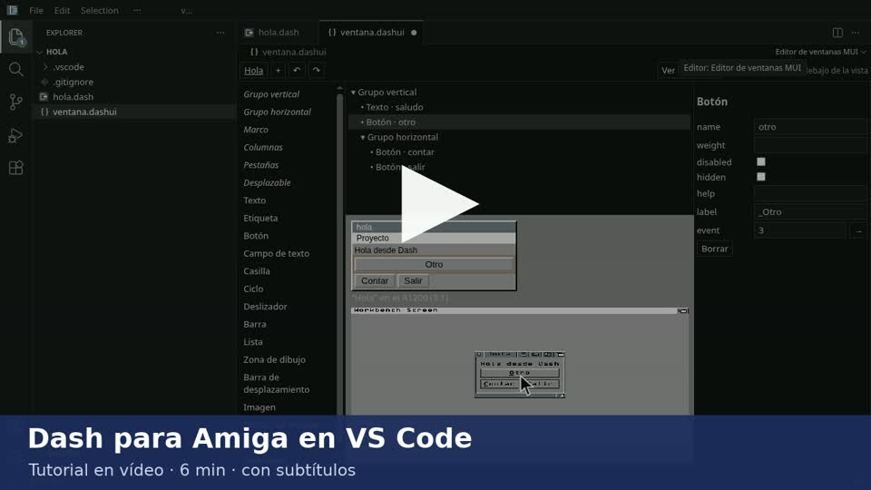

# D.A.S.H.

*English | [Castellano](README.es.md)*

**Development Amiga Synthesis Hub**

A high-level programming language that transpiles to C for the **Commodore Amiga**.

Write clean code, synthesise native executables.

```
Source (.dash) → Parser (Lark) → AST → Analyzer → CodeGen → C → GCC → Amiga Executable
```

## Why Dash

Programming the Amiga in C means manual memory management, pointers, endless includes and knowing the AmigaOS API inside out. Dash removes that friction: a clear syntax inspired by Ruby/Python, inferred types and direct access to Intuition, Graphics, Audio, Sprites, Copper and more.

The result is a native m68k binary. No interpreters, no VM, no compromise.

## Example

```ruby
Window MiVentana
  title "Hola Dash"
  width 400
  height 150
end

Main
  MiVentana.open

  EventLoop
    On Close
      Print "Adiós!"
      Stop
    end
  end
end
```

```bash
./dash examples/hola.dash -o bin/hola
```

## Features

### Language
- Variables with type inference (no declarations)
- Integers (also `0xDFF000`, `$DFF000`, `0b1010`), `Float` (its own floating point) and `Fixed` (16.16 fixed
  point: decimals at integer speed on a 68000)
- `nil` for structs, lists and strings (linked lists, trees, "no target")
- Arithmetic, logical, comparison and bitwise expressions (`& | ^ ~ << >>`, also in `const`)
- Control flow: `if`/`elif`/`else`, `while`, `for`/`in`, `for`/`range` (also descending and with `step`),
  `break` and `continue`
- Functions with parameters, return values and recursion; functions as values and lambdas
- Lists with literals, indexing, slicing, `.length` and an element type (`[String]`, `[Nodo]`...) that grow
  (`push`, `pop`, `insert`, `remove`); dictionaries `{String: T}`, also of lists and of dictionaries, with
  `d.get(clave, defecto)` (a single lookup); the
  functions and methods that return lists or dictionaries keep the type of their elements
- Strings with interpolation of any expression (`"#{a + 1}"`, `"#{f(x)}"`), efficient concatenation and
  functions (`str_find`, `str_replace`, `str_split`, `str_upper`...); a `Bool` is written as `true`/`false`
- Structs with methods, `weak` fields for back references
- Constants and enumerations
- Module imports, and imports of MUI windows made with the visual editor (`.dashui`); anything starting with `_` in
  a module (functions, constants, globals, structs, enums) is private and does not clash with another module
- Lexical scope
- Automatic memory: strings, lists and structs free themselves (per-iteration temporaries and reference
  counting), with no garbage collector and no pauses

### No Gurus from a slip

AmigaOS 3 has no memory protection: in C, a null pointer or a division by zero takes the whole system down.
A Dash program, on the other hand, stops with a message and leaves the Amiga as it was:

- **`nil` fields**: reading or writing a field of a struct that is `nil`, or calling one of its methods, gives
  `Error: campo de nil (en juego.dash:42)`. Without that check, the read would return garbage and the write would
  go to address 0, where the processor's vectors live.
- **Processor exceptions**: odd address, illegal instruction, division by zero, CHK, TRAPV... (what in C is a
  Guru, usually from `@native` code or from a library that gets a bad pointer). Each program installs its own
  handler in its task (`tc_TrapCode`) and, instead of the Guru, says which exception it was and where in the
  executable.

In both cases the program does its usual cleanup (it closes its windows, screens and libraries and frees its
memory) and exits with return code 20; from the Workbench, the message comes up in a requester.
It works on any Amiga, even a 68000 with no MMU, and it costs little: Tachyon (30,000 lines) grows by 0.1%.
What it can't prevent is a write through a wild pointer in your own C code, which can break another part of
the system without anyone noticing. Details in the [manual](docs/MANUAL_REFERENCIA.en.md) ("Runtime
errors").

### Amiga API

627 built-in functions, all implemented (list generated from the code in [docs/BUILTINS.en.md](docs/BUILTINS.en.md)).

- **Intuition** — Windows, screens, event loops (also across several windows), menus, `On Click`, `On Timer`;
  `window_create` with the inner size (flag 8) and the window borders (`window_border_top`...) and the
  screen font (`screen_font_height`, `screen_font_text_width`) for placing gadgets
- **Interfaces** — GadTools (with keyboard shortcuts and gadgets measured with the font), ReAction (up to 4
  windows) and **MUI 3.8 or 5**: a drawing area of its own (with double buffering, fills, repainting just one area with
  `mui_canvas_update_area` and the mouse without clicking with `mui_canvas_on_move` and `mui_canvas_pointer_x`/`_y`),
  timer, signals and full-screen windows (with MUI 3.8 a frame of 4 and 3 pixels remains around them);
  visual editor for MUI windows for VS Code
- **Graphics** — Drawing primitives, colors, bitmaps, transparency and gradients (fast on
  RTG too), RGB24 buffers in the window (also scaled: video)
- **Sprites** — Hardware sprites and soft sprites
- **Copper** — Programmable copper lists
- **Blitter** — BOBs and blitting operations
- **Audio** — Tones, 8SVX samples and sounds built sample by sample (`audio.device`), and ProTracker modules
  (`music_*`, its own player)
- **IFF and datatypes** — ILBM, PNG, JPEG, GIF images, or from RGB/RGBA pixels in memory (with
  transparency, also on RTG and without `picture.datatype`; on RTG, real alpha: they blend with what lies beneath),
  with no limit on images at once (previously 64); disk fonts, including outline fonts (minimum
  size 2: with 1 or 0, AmigaOS 3.2's diskfont and bullet write outside their memory), and RGB colors
- **Network** — With `bsdsocket.library` (any stack: Roadshow, AmiTCP, MiamiDx): TCP as client and as
  server (`net_listen`, `net_accept`), UDP with broadcast (`net_udp_*`) and TLS with AmiSSL (5.1 or later, or
  earlier ones) that checks the certificate; step-by-step connections, without waiting; the TLS session with each
  server is resumed on the next connection; `net_signal` wakes the program when the network has something; the
  network also from a `task_start` task. HTTP is not a builtin: each program implements it over TCP and TLS
- **Processes** — `task_start`: a `@native` function in another AmigaOS process; `task_signal` signals when it finishes
- **Desktop and system** — `desktop_canvas*`: drawing on the Workbench backdrop, behind the icons (planar
  and RTG, with and without backdrop; also with Directory Opus 5 or Scalos as the desktop); `cpu_*`: the CPU use of each
  task; `break_check`: stopping a windowless program with Ctrl-C; `single_instance`: only one copy at a time;
  `@workbench_output "NIL:"`: no console window when started from the icon; `tooltype`; commodities
  (`cx_broker`, `cx_hotkey`, `cx_command`, `cx_wait`: the program in Exchange and with a hotkey);
  `run_program` and `program_relaunch`; `@version` (for `C:Version`) and `program_version()`
- **Monitors** — Mounted disks with their size and free space (`disks_read`); Roadshow network interfaces with
  their state and bytes (`net_ifs_read`); SANA-II drivers in use, with any stack, with their packets and bytes
  (`net_drivers_read`, `net_driver_read`); WiFi signal (`wifi_read`, `wifi_read_device`); Poseidon USB
  devices (`usb_hid_*`); acceleration curve of each mouse (`mouse_curve`) and the mouse preferences
- **Languages, date and time** — `locale.library` catalogs: `@catalog "X.catalog"`, `tr(id, texto)` (also
  in `.dashui` files), `catalog_open`; `tools/catalogo.py` makes the `.cd`, `.ct` and `.catalog` files without FlexCat.
  `clock_read` and `clock_year`... `clock_second`; `date_text(formato)` with `FormatDate` in the user's language
- **DOS** — Files and directories, ASL requesters (file, color, font), arguments and tooltypes,
  watching files (`file_notify`, `file_changed`)
- **RTG** — Graphics cards with CyberGraphX or Picasso96 (`rtg_*`: screens, pixels, blocks, scaling)
- **Double Buffering** — Flicker-free animation
- **FFI** — Direct calls to C/AmigaOS functions; your own C inline (`@native`, `@c`) or linked (`@link`),
  with its headers (`@header`) and declared C functions (`@extern`)

Programs need Kickstart 3.0 or higher (they use exec V39 memory pools) and run on
a 68000. MUI (3.8 or 5) and TLS (AmiSSL 5.1 or later) require a 68020 or higher. Some functions require
more: networking, a TCP/IP stack; `net_ifs_read` and `wifi_read`, Roadshow; `usb_hid_*`, Poseidon; ReAction, the
AmigaOS 3.2 classes.

### What is not there

- HTTP as a builtin: each program implements it over TCP and TLS.
- Raw sockets (ICMP, for a ping) or raw frames from a SANA-II driver: for now, with `@native`.
- Classes (OOP) and macros: these are open questions, undecided.
- Exports: deliberately ruled out.

## Programs made with Dash

- [Tachyon](https://github.com/FreeMEM/tachyon) (formerly dashweb): a web browser for the Amiga with MUI: XHTML,
  CSS, JavaScript (QuickJS) and HTTPS. It is the largest project written in Dash, and whatever it lacks gets added to
  Dash. It has alpha test versions in its [releases](https://github.com/FreeMEM/tachyon/releases).
- [Trasfondo](https://github.com/FreeMEM/trasfondo): a resource monitor (date and time, CPU, memory,
  tasks, disks, network and WiFi) painted on the Workbench backdrop, behind the icons; it is a commodity.
  Versions in its [releases](https://github.com/FreeMEM/trasfondo/releases).
- Ratonera: per-device mouse acceleration (`mouse_curve`, `usb_hid_*`), in development.

## Developing in VS Code

The extension in `editor/vscode` turns VS Code into an environment for Dash: syntax coloring, errors as you type,
completion, go to definition and rename; compiling and running on the emulated Amiga (A1200, A500, AmigaOS 3.2 or
with a graphics card); debugging with breakpoints, variables and stepping, also on a real Amiga over the
network; and a visual editor for MUI windows that shows them in the emulator. It uses the compiler from this repository.
The published version is 0.2.3.

[](https://youtu.be/_UTJ_0s3xLc)

A 6-minute tutorial, with subtitles: the first project, writing code, the window, compiling and running,
debugging and debugging on a real Amiga.

### Installing the extension

1. Dash and the Amiga compiler, as in [Quick installation](#quick-installation) (for the emulator, FS-UAE and a
   Kickstart ROM; for MUI windows, `tools/get_mui_sdk.sh` and `tools/emu_sys_mui.sh`).
2. The extension: the file `dash-mui-editor-0.2.3.vsix` from the [release](https://github.com/FreeMEM/dash/releases/tag/vscode-0.2.3), and in VS Code (1.86 or later)
   **Extensions: Install from VSIX...**, or `code --install-extension dash-mui-editor-0.2.3.vsix`. It can also
   be built: `cd editor/vscode && npm install && npm run package`.
3. A project: **Dash: Nuevo proyecto**. If its folder is not inside this repository, **Dash: Elegir la
   carpeta del compilador** (the `dash.path` setting). The **Primeros pasos con Dash** walkthrough guides you step by step, and if
   something is missing the extension says what and how to get it.

### How it fits with Dash

The extension is a thin layer: what it does is done by the tools in this repository, in the
`dash.path` folder.

| In VS Code | Done by |
|---|---|
| Syntax coloring | `editor/vscode/syntaxes/dash.tmLanguage.json`, generated from the grammar (`tools/gen_tmgrammar.py`) |
| Errors as you type, completion, go to definition, rename, format | `compiler/lsp.py` (the same compiler) |
| Compile | `./dash` |
| Run, memory and profile | `./dash` and `tools/emu_run.py` (FS-UAE or Amiberry) |
| Visual editor and Ver en Amiga | `.dashui` (`compiler/dashui.py`) and `tools/emu_preview.py` |
| Debug (F5) | `./dash --debug`, `tools/emu_run.py --gdbserver`, `m68k-amigaos-gdb` with `tools/gdb/dash.py` and `bgdbserver` |

That is why, when you update Dash (`git pull`), what the extension knows about the language is updated too, without
reinstalling it. The extension and the compiler live in the same repository so that they do not drift apart.

## Quick installation

### Ubuntu / Debian

```bash
# 1. System dependencies
sudo apt update
sudo apt install -y python3 python3-pip python3-dev make wget curl openssl git gcc g++ \
    lhasa libgmp-dev libmpfr-dev libmpc-dev flex bison \
    gettext texinfo ncurses-dev autoconf rsync libreadline-dev

# 2. Dash parser
pip install lark --break-system-packages

# 3. Cross-compiler for the Amiga (m68k-amigaos-gcc)
git clone https://github.com/BlitterStudio/m68k-amigaos-gcc.git ~/m68k-amigaos-gcc
cd ~/m68k-amigaos-gcc
make update
sudo mkdir -p /opt/amiga && sudo chown $USER /opt/amiga
make all -j$(nproc)
make sdk=cgx            # CyberGraphX headers (rtg_* functions)

# 4. Add to PATH
echo 'export PATH="/opt/amiga/bin:$PATH"' >> ~/.bashrc
source ~/.bashrc

# 5. Clone Dash and try it
git clone https://github.com/FreeMEM/dash.git
cd dash
./dash examples/hola.dash -o bin/hola
```

### CachyOS / Arch Linux

```bash
# 1. System dependencies
sudo pacman -S --needed python python-pip make wget curl openssl git gcc \
    lhasa gmp mpfr libmpc flex bison gettext texinfo \
    ncurses autoconf rsync readline

# 2. Dash parser
pip install lark --break-system-packages

# 3. Cross-compiler for the Amiga (m68k-amigaos-gcc)
git clone https://github.com/BlitterStudio/m68k-amigaos-gcc.git ~/m68k-amigaos-gcc
cd ~/m68k-amigaos-gcc
make update
sudo mkdir -p /opt/amiga && sudo chown $USER /opt/amiga
make all -j$(nproc)
make sdk=cgx            # CyberGraphX headers (rtg_* functions)

# 4. Add to PATH
echo 'export PATH="/opt/amiga/bin:$PATH"' >> ~/.zshrc
source ~/.zshrc

# 5. Clone Dash and try it
git clone https://github.com/FreeMEM/dash.git
cd dash
./dash examples/hola.dash -o bin/hola
```

> Building the cross-compiler takes between 30 minutes and 2 hours depending on your hardware. See [docs/INSTALACION.en.md](docs/INSTALACION.en.md) for the full guide, troubleshooting and advanced options (macOS, GCC versions, elf2hunk).

## Usage

```bash
# Compile to an Amiga executable (optimized with gcc -O2)
./dash archivo.dash -o bin/archivo

# Unoptimized (easier to debug)
./dash -O0 archivo.dash -o bin/archivo

# For the debugger (gdb, VS Code): -O0 -g and the C lines point to the .dash
./dash --debug archivo.dash -o bin/archivo

# Quiet: only warnings, errors and the result (not every command and step)
./dash -q archivo.dash -o bin/archivo

# Smaller (gcc -Os): ~7 % smaller, 10-50 % slower in loops
./dash --small archivo.dash -o bin/archivo

# Minimum program stack (16 KB by default; 0 = whatever the shell gives, 720 bytes less)
./dash --stack 32768 archivo.dash -o bin/archivo

# For Amigas with a 68881/68882 FPU (Float with FPU instructions; 68020+)
./dash --fpu archivo.dash -o bin/archivo

# For accelerated Amigas: code for that CPU or better (68020, 68030, 68040, 68060); it will not start on a lower one
./dash --cpu 68040 archivo.dash -o bin/archivo

# Memory check: warns about double frees and use after free, and about what is still alive at exit
./dash --memcheck archivo.dash -o bin/archivo

# Profile: calls and time (own and total) of each function at exit
./dash --profile archivo.dash -o bin/archivo

# Run in FS-UAE without a window and see the output (Kickstart in $DASH_KICKSTART or AROS)
tools/emu_run.py archivo.dash
tools/emu_run.py --autoclose 3 ventana.dash   # closes by itself after 3 s
tools/emu_run.py --autoclose 30 --screenshot 20 shot.png ventana.dash   # screenshot after 20 s
tools/emu_run.py --debug r archivo.dash       # at each debug_break(), the registers (FS-UAE debugger)

# Compile all the examples
./compile_all.sh

# Only transpile to C (without compiling)
python3 -m compiler.main archivo.dash -o build/archivo.c

# Run tests (--emu: also those that check the output in FS-UAE; --emu-a500: also on an A500;
# --emu-32: also on an A1200 with AmigaOS 3.2, the only one that tests ReAction)
python3 tests/run_tests.py
python3 tests/run_tests.py --emu --emu-a500 --emu-32

# Measure speed, memory and size on an emulated A500 and A1200, and save the measurement
tools/bench.py --save "descripción del cambio"
tools/bench_report.py        # data and page for the comparison dashboard (build/bench_report/)

# Random programs against reference counting: output compared with a model and --memcheck
tools/fuzz_refcount.py -n 100
```

Test bench variables: `DASH_KICKSTART` (A1200 ROM), `DASH_KICKSTART_A500` (A500 ROM),
`DASH_EMU_SYS` (directory with `Libs`, `C` and `Classes` from a Workbench, for the tests that need it; it
can be extracted from a hard disk with `tools/emu_sys_from_hdf.sh`), and for `--emu-32` `DASH_KICKSTART_32` (3.2 ROM)
and `DASH_EMU_SYS_32` (the same files from a Workbench 3.2). On that machine the Workbench is loaded before
the programs (`emu_run.py --workbench`): the 3.2 `window.class` expects it. For MUI and HTTPS, the systems with
MUI (`DASH_EMU_SYS_MUI`, `DASH_EMU_SYS_32_MUI`) and with AmiSSL (`DASH_EMU_SYS_SSL`, `DASH_EMU_SYS_32_SSL`). The
`# rtg` tests use a 68040 machine with a graphics card and `DASH_EMU_SYS_32_RTG` (a Workbench 3.2 with
Picasso96). All of it in [docs/INSTALACION.en.md](docs/INSTALACION.en.md).

## Project structure

```
dash                  Main CLI
compiler/             Transpiler (Python/Lark)
  grammar.py          Language grammar
  transformer.py      Parse tree → AST
  ast_nodes.py        AST nodes
  analyzer.py         Semantic analysis
  codegen.py          C code generation
  amiga_builtins.py   Amiga API bindings
  dashui.py           Visual editor windows (.dashui) as Dash code
  lsp.py              Language server for VS Code (with lsp_index.py and lsp_format.py)
  debuglines.py       ./dash --debug: C lines mapped to the .dash
lib/amiga/            Standard Amiga modules
runtime/softfloat/    Software floating point (addition and multiplication in 68000 assembly)
tools/                Emulator (emu_run.py, emu_preview.py, screenshots with tools/amiga/shot.c), emulated systems
                      (emu_sys_*.sh), MUI SDK, AmiSSL and bgdbserver (get_*.sh), debugger (gdb_relay.py,
                      gdb/dash.py), benchmarks (bench.py, bench_report.py), catalogs (catalogo.py),
                      fuzz_refcount.py, gen_builtins_doc.py, gen_tmgrammar.py
editor/vscode/        VS Code extension: syntax coloring, errors as you type, compiling, emulator, debugger, MUI
                      visual editor
examples/             Example programs (34)
tests/                Test suite (tests/errors: must fail; tests/runtime: runtime on the PC;
                      tests/lsp and tests/unit: Python tests; tests/bench: benchmarks)
docs/                 Documentation
```

## Documentation

- [Language documentation](docs/DOCUMENTACION_LENGUAJE.en.md) — Complete guide
- [Reference manual](docs/MANUAL_REFERENCIA.en.md) — Programmer's reference
- [Comparison with Blitz, AMOS and C](docs/COMPARATIVA.en.md) — Speed, memory and stability measured on the A500 and A1200
- [Quick Reference](docs/QUICK_REFERENCE.en.md) — Cheat sheet
- [Built-in functions](docs/BUILTINS.en.md) — The actual list, generated from the code
- [MUI in Dash](docs/MUI_DISEÑO.en.md) — Design of the MUI API
- [MUI visual editor](docs/MUI_EDITOR.en.md) — The `.dashui` format and the VS Code extension
- [Amiga API](docs/AMIGA_API.en.md) — Design catalogue of the API (the original; the actual list is BUILTINS.en.md)
- [Installation](docs/INSTALACION.en.md) — Setting up the environment
- [Functional requirements](docs/REQUERIMIENTOS_FUNCIONALES.md) and [system requirements](docs/REQUERIMIENTOS_SISTEMA.md) —
  The original requirements, with what was done, what was ruled out and what is missing
- [Roadmap](docs/ROADMAP.md) — Development plan and log of what has been done

## Licence

MIT (see [LICENSE](LICENSE)). Programs compiled with Dash can carry any licence you like.
The software float (`runtime/softfloat/fp-bit.*`) comes from GCC: GPL with the runtime exception,
which allows the programs to be distributed under any licence.
