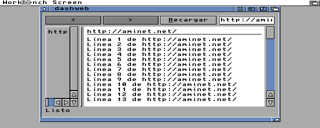

# D.A.S.H. Language - Manual de Referencia del Programador

**Version 1.2** | **D.A.S.H.** (*Development Amiga Synthesis Hub*) — Lenguaje de alto nivel para Amiga que compila a C

*Actualizado: Enero 2026 - Incluye Screens, GadTools y ReAction*

---

## Tabla de Contenidos

1. [Introduccion](#1-introduccion)
2. [Estructura del Programa](#2-estructura-del-programa)
3. [Variables y Tipos de Datos](#3-variables-y-tipos-de-datos)
4. [Constantes](#4-constantes)
5. [Operadores](#5-operadores)
6. [Estructuras de Control](#6-estructuras-de-control)
7. [Funciones](#7-funciones)
8. [Estructuras (Structs)](#8-estructuras-structs)
9. [Enumeraciones](#9-enumeraciones)
10. [Arrays](#10-arrays)
11. [Screens (Pantallas)](#11-screens-pantallas)
12. [Ventanas y Eventos](#12-ventanas-y-eventos)
13. [Graficos](#13-graficos)
14. [Entrada (Teclado, Raton, Joystick)](#14-entrada-teclado-raton-joystick)
15. [Audio y Musica](#15-audio-y-musica)
16. [Sistema de Archivos](#16-sistema-de-archivos)
17. [Gestion de Memoria](#17-gestion-de-memoria)
18. [Funciones del Sistema](#18-funciones-del-sistema)
19. [Interfaz de Usuario - GadTools](#19-interfaz-de-usuario---gadtools)
20. [Interfaz de Usuario - ReAction](#20-interfaz-de-usuario---reaction)
20b. [Interfaz de Usuario - MUI](#20b-interfaz-de-usuario---mui)
21. [Modulos e Imports](#21-modulos-e-imports)
22. [Ejemplos Completos](#22-ejemplos-completos)
23. [Referencia Rapida](#23-referencia-rapida)

---

## 1. Introduccion

Dash es un lenguaje de programacion de alto nivel disenado para crear aplicaciones y juegos para Amiga. El compilador traduce codigo Dash a C optimizado que puede compilarse con cualquier compilador C para Amiga.

### Caracteristicas Principales

- Sintaxis clara y moderna inspirada en Ruby y Python
- Integracion nativa con AmigaOS (Intuition, Graphics, DOS)
- Sistema de ventanas y graficos simplificado
- 240+ funciones built-in para graficos, audio, archivos, GUI y mas
- Structs con metodos (programacion orientada a objetos ligera)
- Gestion automatica de memoria con Reference Counting
- Arena Allocators para rendimiento maximo

### Hola Mundo

```
Main
    Print "Hola Amiga!"
end
```

### Compilacion

```bash
./dash programa.dash -o programa              # gcc -O2, para 68000
./dash -O0 programa.dash -o programa          # sin optimizar (para depurar)
./dash --small programa.dash -o programa      # gcc -Os: ~7 % mas pequeno, bucles mas lentos
./dash --stack 32768 programa.dash -o prog    # pila minima (por defecto 16 KB; 0 = la del shell)
./dash --fpu programa.dash -o programa        # solo 68020 con FPU 68881/68882
./dash --memcheck programa.dash -o programa   # comprobacion de memoria (para pruebas)
```

`./dash --debug` compila para el depurador: `-O0 -g` (DWARF en el ejecutable) y, en el C, `#line` hacia las
lineas del `.dash`: `m68k-amigaos-gdb` para, avanza y ensena la pila y las variables en lineas de Dash
(con `bgdbserver` en el Amiga: ver la extension de VS Code). Sin `--debug` el C no cambia. Con `--debug`, ademas:
cada `Print` sale en el momento; si la variable de DOS `DASH_OUT` tiene un nombre de fichero, la salida va ahi;
un error del programa (indice fuera de la lista, error de memoria) llama a `_dash_debug_stop`, donde el depurador
para; y las globales a cero (`.bss`) van en el mismo bloque que las demas, para que gdb las encuentre
(`tools/gdb_relay.py`). El ejecutable crece lo que ocupan.

Con `--memcheck`, cada error de memoria dice tambien donde paso: `memcheck: ERROR campo de nil (en
prog.dash:15)` (cada sentencia apunta su fichero y linea; solo en esas compilaciones).

Con `DASH_PRINT_FLUSH=1` al compilar, cada `Print` sale en el momento (`Flush` de dos.library) aunque la
salida vaya a un fichero: así la ven en vivo `tools/emu_run.py --follow` y la extension de VS Code. Sin ella
el C no cambia.

Los errores del compilador dicen dónde: `fichero.dash:línea:columna: Error: mensaje` (también los de un
módulo importado, con su fichero), como gcc: los editores los enlazan con el código. Los de sintaxis se
dicen en una frase (`sintaxis: no se esperaba ... aquí; se esperaba ...`).

Los programas necesitan Kickstart 3.0 o superior. Al arrancar piden una pila de al menos 16 KB:
el shell de 3.1 da 4 KB y una recursion algo honda la desbordaria (cuesta 720 bytes por programa;
`--stack 0` lo quita). Con MUI piden 32 KB y con TLS 64 KB. Un programa o un modulo que necesita
mas lo dice con `@stack 262144` (en bytes, al nivel de las funciones): el programa toma la mayor de
todas; `--stack` sigue mandando.

Arrancado desde el Workbench (su icono), un programa no tiene consola: lo primero que escribe abre una
ventana `CON:` de libnix. `@workbench_output "NIL:"` (al nivel de las funciones) la quita: lo escrito se
pierde. Vale cualquier fichero o ventana, por ejemplo `@workbench_output "CON:0/0/640/200/Mi programa/AUTO/CLOSE"`.
Desde la Shell no cambia nada. Si la ponen el programa y un modulo, manda la del programa.

`--profile` compila una version que, al salir, escribe una tabla con las llamadas a cada funcion y
el tiempo que paso en ella (propio) y en lo que llama (total), de la mas lenta a la mas rapida
(`perfil: ...`). El tiempo se mide mirando 50 veces por segundo donde esta el programa (interrupcion
VBlank): hacen falta unos segundos de ejecucion para que sea fiable.

`--memcheck` compila una version de prueba que vigila la memoria de listas, structs y textos. Avisa
en cuanto algo se libera dos veces o se usa despues de liberarse (`memcheck: ERROR ...`) y, al
salir, dice cuanto queda vivo:

```
memcheck: vivos 0 objetos y 0 strings (escapados 0 y 0), errores 0
```

"Escapados" son los que se guardaron dentro de una lista o se dieron a codigo C: se liberan al
salir del programa. Para que la cuenta sea util, `Main` suelta sus variables al acabar (solo en
este modo). Los bloques liberados se rellenan con `0xDB` y los 64 ultimos no se reutilizan, para
reconocerlos. Es mas lento y gasta algo mas de memoria; sin la opcion no cuesta nada.

---

## 2. Estructura del Programa

### Estructura Basica

```
# Imports (opcional)
import "lib/utils.dash"

# Constantes (opcional)
const MAX_ENEMIES = 10
const TITLE = "Mi Juego"

# Enumeraciones (opcional)
enum GameState
    MENU
    PLAYING
    PAUSED
end

# Estructuras (opcional)
struct Player
    x: Int
    y: Int
end

# Definicion de Ventanas (opcional)
Window MainWindow
    title "Mi Aplicacion"
    width 320
    height 200
end

# Funciones (opcional)
func calculate(a, b)
    return a + b
end

# Bloque Principal (requerido)
Main
    # Codigo del programa
    Print "Iniciando..."
end
```

### Comentarios

```
# Esto es un comentario de una linea
x = 10  # Comentario al final de linea
```

---

## 3. Variables y Tipos de Datos

### Declaracion de Variables

Las variables se declaran implicitamente en su primera asignacion:

```
# Enteros
edad = 25
puntuacion = -100
hex_value = 0xFF       # hexadecimal (también $FF, al estilo Amiga)
bits = 0b1010          # binario

# Strings
nombre = "Amiga"
mensaje = "Hola Mundo"

# Booleanos
activo = true
pausado = false

# Arrays
numeros = [1, 2, 3, 4, 5]
vacio = []
```

### Tipos de Datos

| Tipo | Descripcion | Ejemplo |
|------|-------------|---------|
| Int | Entero 32-bit con signo | `42`, `-100`, `0xFF`, `$DFF000`, `0b1010` |
| Float | Decimal de 32 bits (unos 7 digitos) | `1.5`, `-0.25`, `2.0e3` |
| Fixed | Coma fija 16.16: decimales rapidos en 68000 | `Fixed(1.5)`, `Fixed(n)` |
| String | Cadena de texto | `"Hola"` |
| Bool | Valor booleano (`Print` y los textos lo escriben `true` / `false`) | `true`, `false` |
| Array | Coleccion de elementos | `[1, 2, 3]` |
| Struct | Tipo compuesto definido por usuario | `Player(10, 20)` |

### Fixed (coma fija)

`Fixed` guarda un numero con decimales en un entero de 32 bits: 16 bits de parte entera y 16 de
decimales. Rango de -32768 a 32767,9999, con un paso de 1/65536 (unas 4 cifras decimales). En un
68000 sin FPU es mucho mas rapido que `Float`:

| Operacion (A500, ciclos) | Fixed | Float |
|--------------------------|-------|-------|
| Suma, resta, comparacion | como un entero | ~750 |
| Multiplicacion | ~390 | ~940 |
| Por o entre un entero | como un entero | ~940 |
| Division | ~2.200 | |

```
v = Fixed(1.5)              # un literal se calcula al compilar
g = Fixed(0.35)
y = Fixed(0)
y = y + v                   # suma de enteros
v = v * Fixed(0.85)         # Fixed * Fixed
v = v * 2                   # por un entero: multiplicacion entera
x = Int(y)                  # trunca hacia cero
Print "y = #{y}"            # hasta 4 decimales: y = 1.5
r = fx_sqrt(Fixed(2))       # 1.4142
s = fx_sin(Fixed(30))       # 0.5 (grados); tambien fx_cos
```

- Un entero dado a un `Fixed` (variable, campo, parametro, `return`) se convierte solo:
  `var v: Fixed = 3`, `b.x = 2`, `mitad(5)` con `func mitad(v: Fixed)`.
- Mezclar `Fixed` y `Float` es un error: hay que convertir con `Fixed(f)` o `Float(x)`.
- Si se pasa del rango da la vuelta, como un entero. Dividir entre 0 da el valor maximo con
  el signo del dividendo (no cuelga el Amiga).
- Campos, parametros y retornos pueden ser `Fixed`. Ejemplo completo: `examples/fixed_gravedad.dash`.
- Listas de `Fixed`: un literal con algun `Fixed` (`[Fixed(1.5), 2, Fixed(-0.25)]`: los numeros se
  convierten), o declaradas `[Fixed]` (variables, parametros, retornos, campos). `l[i]`, `push`, `insert`,
  `pop`, `for v in l`, trozos y `+` dan y reciben `Fixed`; `l.push(2)` guarda 2.0. Se guardan como una
  lista de enteros (un `Fixed` es un `LONG`). Una lista de `Float` sigue sin poder hacerse.

### Inferencia de Tipos

El tipo se infiere automaticamente:

```
x = 10          # Int
name = "Dash"   # String
flag = true     # Bool
nums = [1,2,3]  # Array de Int
v = 1.5         # Float
```

### Float

```
v = 2.5
area = 3.14159 * r * r      # Int y Float se mezclan: el resultado es Float
n = Int(v)                  # 2 (trunca hacia cero)
f = Float(7) / 2            # 3.5 (7 / 2 entre enteros da 3)
Print "v = " + v            # v = 2.5
Print "#{v} metros"

struct Cuerpo
    masa: Float
end

func doble(x: Float) -> Float
    return x * 2.0
end
```

- Un literal decimal necesita digitos a los dos lados del punto: `1.0`, no `1.` (asi `1..10` sigue siendo un rango).
- Una variable que empezo siendo Int no puede recibir un Float (`n = 0` y luego `n = 2.5` es error):
  declarala con `n = 0.0` o convierte con `Int()`.
- `%` solo con enteros. Los arrays guardan enteros o strings, no Float.
- `./dash --fpu` compila para 68020 + FPU 68881/68882: los Float usan instrucciones de la FPU
  (mucho mas rapido, y el ejecutable es mas pequeno). En una maquina sin FPU, libnix muestra un
  aviso del sistema y el programa termina. Como LightWave: una version para cada maquina.
- Sin `--fpu` (un 68000 no tiene FPU) las operaciones son por software (rutinas de GCC en
  `runtime/softfloat`, unos 4 KB, solo si el programa usa Float). No dependen de
  `mathieeesingbas.library`, que con Kickstart 3.1 sin FPU se cuelga en FS-UAE.

---

## 4. Constantes

Las constantes se definen con `const` y no pueden modificarse:

```
const MAX_VIDAS = 3
const SCREEN_WIDTH = 320
const SCREEN_HEIGHT = 200
const GAME_TITLE = "Space Invaders"
const DEBUG_MODE = true
const AREA = SCREEN_WIDTH * SCREEN_HEIGHT   # expresion entera: se calcula al compilar
const BIT_FUEGO = 1 << 7
```

El valor es un literal (numero, texto, `true`/`false`, `Float`) o una expresion entera de numeros y
constantes declaradas antes (`+ - * / %` y los operadores de bits); se calcula al compilar, en 32 bits.

### Uso de Constantes

```
Main
    Print GAME_TITLE

    for i in (1..MAX_VIDAS)
        Print "Vida: "
        Print i
    end

    if DEBUG_MODE
        Print "Modo debug activo"
    end
end
```

---

## 5. Operadores

### Operadores Aritmeticos

| Operador | Operacion | Ejemplo |
|----------|-----------|---------|
| `+` | Suma | `a + b` |
| `-` | Resta | `a - b` |
| `*` | Multiplicacion | `a * b` |
| `/` | Division | `a / b` |
| `%` | Modulo | `a % b` |
| `-` | Negacion (unario) | `-x` |

```
resultado = (10 + 5) * 2    # 30
resto = 17 % 5              # 2
negativo = -valor
```

### Operadores de Bits

Sobre enteros (un `Float` o un `Fixed` se convierte antes con `Int()`):

| Operador | Operacion | Ejemplo |
|----------|-----------|---------|
| `&` | Y de bits | `color & 0xFF` |
| `\|` | O de bits | `flags \| 4` |
| `^` | O exclusivo | `a ^ b` |
| `~` | Complemento (unario) | `~mascara` |
| `<<` | Desplazar a la izquierda | `1 << 4` |
| `>>` | Desplazar a la derecha (aritmetico: conserva el signo) | `rgb >> 16` |

Precedencia como en Python: los desplazamientos van por encima de `&`, que va por encima de `^`, que
va por encima de `|`; todos por debajo de `+ -` y por encima de las comparaciones. Asi `1 + 2 << 1`
es 6 y `a & 4 == 4` es `(a & 4) == 4` (en C seria al reves). `~` va como el `-` unario.

```
const MASCARA = 1 << 4             # una const puede ser una expresion entera de numeros y
const TODOS = (1 << 8) - 1         # constantes de antes: se calcula al compilar (255)
rojo = (rgb >> 16) & 0xFF
if flags & MASCARA != 0
    Print "activo"
end
```

### Operadores de Comparacion

| Operador | Significado |
|----------|-------------|
| `==` | Igual a |
| `!=` | Diferente de |
| `<` | Menor que |
| `>` | Mayor que |
| `<=` | Menor o igual |
| `>=` | Mayor o igual |

Con textos, `==` y `!=` comparan el contenido, y `<`, `>`, `<=`, `>=` el orden: byte a byte, como
`strcmp` (`"abc" < "abd"`, `"" < "a"`, mayusculas antes que minusculas).

### Operadores Logicos

| Operador | Significado |
|----------|-------------|
| `and` | Y logico |
| `or` | O logico |
| `not` | Negacion |

```
if x > 0 and x < 100
    Print "En rango"
end

if not activo or pausado
    Print "Detenido"
end
```

### Concatenacion de Strings

```
saludo = "Hola " + nombre + "!"
Print saludo
```

### Interpolacion

Dentro de `#{...}` va cualquier expresion: una variable, una llamada, una cuenta, un campo, un elemento...

```
Print "Hola #{nombre}, tienes #{puntos * 10} puntos"
Print "#{p.x},#{p.y} de #{lista.length} (#{doble(n)})"
Print "#{a}#{b}"            # siempre texto: con a = 1 y b = 2 da "12"
Print "#{str_upper(\"ok\")}"   # las comillas de dentro van escapadas: \"
```

El resultado es siempre un texto, aunque solo haya un numero (`"#{n}"`). Un `#{` sin su `}` se queda tal cual.

### Funciones de texto

Devuelven textos nuevos (el original no cambia) o numeros. Las posiciones empiezan en 0.

| Funcion | Que hace |
|---|---|
| `s.length`, `s[i]` | Longitud y caracter en la posicion `i` (`""`/0 fuera del texto) |
| `str_code(s, i)`, `Int(s[i])` | Codigo del caracter (0-255, Latin-1) |
| `str_char(codigo)` | Texto de un caracter con ese codigo |
| `str_find(s, sub)`, `str_find_from(s, sub, desde)` | Posicion de `sub`, o -1 |
| `str_starts(s, prefijo)`, `str_ends(s, sufijo)` | Empieza / termina por |
| `str_lower(s)`, `str_upper(s)` | Minusculas / mayusculas (tambien `Ñ`, `É`...) |
| `str_trim(s)` | Sin espacios, tabuladores ni saltos de linea a los lados |
| `Int(s)`, `str_to_int(s, base)` | Numero escrito en el texto (`Int("42")`, `str_to_int("ff", 16)`) |
| `str_from_int(n, base)` | Numero escrito en otra base (`str_from_int(255, 16)` = `"ff"`) |
| `str_replace(s, de, a)` | Cambia todas las apariciones de `de` por `a` |
| `str_contains(s, sub)` | Si `sub` esta en `s` (`""` esta en todos) |
| `str_split(s, sep)` | Los trozos entre cada `sep`, en una lista nueva `[String]`; con `sep` `""` o si no esta, `[s]`; dos `sep` seguidos dan `""` |
| `file_read_text(nombre)` | El fichero entero como texto (`nil` si no se puede leer) |
| `file_write_text(nombre, texto)` | Escribe el texto como fichero entero (`true` si fue bien) |
| `str_from_buffer(buffer, desde, n)` | Texto con `n` bytes de un buffer |
| `str_to_buffer(s, buffer, desde)` | Copia los bytes del texto al buffer; devuelve cuantos |

Un texto termina en el primer byte 0, asi que al leer ficheros o buffers los bytes 0 se
convierten en espacios. Para datos binarios, usar los buffers (`buffer_get_byte`...).

Recorrer un texto largo por posicion es rapido: la longitud de los textos largos se
recuerda, asi que `while i < s.length` con `s[i]` no lo mide en cada vuelta.

```
linea = str_trim(linea)
if str_starts(linea, "#")
    continue
end
p = str_find(linea, "=")
clave = str_lower(linea[:p])
valor = Int(linea[p + 1:])
```

### Precedencia de Operadores

1. `-` (unario)
2. `*`, `/`, `%`
3. `+`, `-`
4. `==`, `!=`, `<`, `>`, `<=`, `>=`
5. `not` (como en Python: `not a == b` es `not (a == b)`)
6. `and`
7. `or`

---

## 6. Estructuras de Control

### If / Else

```
if condicion
    # codigo si verdadero
end

if edad >= 18
    Print "Adulto"
else
    Print "Menor"
end
```

### If / Elif / Else

Con `elif` se encadenan condiciones sin anidar; se prueba cada una en orden y solo se ejecuta
la primera que se cumple (o el `else`, si ninguna):

```
if puntos >= 1000
    Print "Experto"
elif puntos >= 500
    Print "Intermedio"
else
    Print "Principiante"
end
```

Es lo mismo que anidar un `if` dentro del `else` (y genera el mismo C).

### While

```
contador = 10
while contador > 0
    Print contador
    contador = contador - 1
end
Print "Despegue!"
```

### For con Rango

Itera desde `inicio` hasta `fin` (ambos incluidos):

```
# Imprime 1, 2, 3, 4, 5
for i in (1..5)
    Print i
end

# Hacia atrás: 5, 4, 3, 2, 1 (los dos límites son constantes y inicio > fin)
for i in (5..1)
    Print i
end

# Con paso: 0, 5, 10 / 10, 7, 4, 1
for i in (0..10 step 5)
    Print i
end
for i in (10..1 step -3)
    Print i
end

# Cuenta regresiva usando variable: con límites variables el rango
# siempre sube ((1..0) no da vueltas), así que hace falta step -1
for i in (n..1 step -1)
    Print i
end
```

`step` no puede ser 0. Si es una variable, su signo decide al ejecutar si el bucle sube o baja.

### For Each (Iteracion de Arrays)

```
enemigos = [enemy1, enemy2, enemy3]

for enemigo in enemigos
    enemigo.mover(1, 0)
end
```

### break y continue

```
for i in (1..10)
    if i % 2 == 0
        continue        # salta los pares
    end
    if i > 7
        break           # termina el bucle
    end
    Print i
end
```

Solo valen dentro de un `while` o `for`. Dentro de un manejador `On Close`/`On Key`
(aunque el `EventLoop` esté dentro de un bucle) son un error: para salir del
`EventLoop` se usa `Stop`.

### Comandos de Control

| Comando | Efecto |
|---------|--------|
| `Stop` | Sale del EventLoop y termina programa |
| `break` | Sale del `while`/`for` más interno |
| `continue` | Salta a la siguiente vuelta del `while`/`for` más interno |
| `return valor` | Retorna de una funcion con valor |
| `return` | Retorna de una funcion sin valor |

---

## 7. Funciones

### Definicion Basica

```
func saludar()
    Print "Hola!"
end

func duplicar(n)
    return n * 2
end
```

### Con Anotaciones de Tipo

```
func sumar(a: Int, b: Int) -> Int
    return a + b
end

func crear_mensaje(nombre: String) -> String
    return "Bienvenido " + nombre
end

func siguientes(a: Array) -> Array     # lista de enteros
    return [a[0] + 1, a[1] + 1]
end
```

Tipos que se pueden escribir: `Int`, `Float`, `String`, `Bool`, `Array`, `Pointer`, `Func`, `Void` y el
nombre de un struct o de un enum. Cualquier otro nombre es un error (antes se tomaba como `Int` sin avisar).
Un campo `Array` de un struct se libera con el struct, igual que un campo de tipo struct.

El `return` se comprueba contra el tipo declarado: es un error devolver un texto donde va un numero o un
`Bool` (y al reves), un struct de otro tipo, `nil` en una funcion de `Int`, `Float`, `Fixed` o `Bool`, o un
valor en una funcion `Void`. Un entero vale para `Bool` y para `Fixed` (se convierte).

### Llamada a Funciones

```
saludar()
resultado = duplicar(21)
suma = sumar(10, 20)
```

### Funciones Recursivas

```
func factorial(n)
    if n <= 1
        return 1
    end
    return n * factorial(n - 1)
end
```

---

## 8. Estructuras (Structs)

### Definicion

```
struct Enemigo
    x: Int
    y: Int
    vida: Int = 100     # Valor por defecto
    nombre: String
end
```

### Creacion de Instancias

```
# Constructor con todos los campos
e1 = Enemigo(100, 50, 100, "Alien")

# Acceso a campos
Print e1.x
Print e1.nombre
e1.vida = e1.vida - 10
```

### Structs dentro de structs

Un campo puede ser de otro tipo struct. Se lee y se asigna encadenando puntos:

```
struct Punto
    x: Int
    y: Int
end

struct Sprite
    pos: Punto
end

s = Sprite(Punto(10, 20))
s.pos.x = 15            # también self.pos.x dentro de un método
Print s.pos.x

var lista: [Punto] = [Punto(1, 2), Punto(3, 4)]
lista[0].x = 5          # el campo de un elemento de una lista (también caja.items[i].nombre)
lista[0].mover(1)       # y sus métodos; d["k"].push(x) en un {String: [T]}
```

Para asignar `a.b.c` el compilador tiene que saber que `a.b` es un struct: la variable
debe venir de un constructor (`Sprite(...)`), de una función con tipo de retorno struct,
o ser un parámetro con tipo (`func f(s: Sprite)`). Si no, da error.
Asignar un campo que el struct no tiene también es error.

### Metodos

```
struct Jugador
    x: Int = 0
    y: Int = 0
    velocidad: Int = 5

    func mover(dx, dy)
        self.x = self.x + dx * self.velocidad
        self.y = self.y + dy * self.velocidad
    end

    func dibujar()
        gfx_rect(self.x, self.y, self.x + 16, self.y + 16)
    end

    func reset()
        self.x = 160
        self.y = 100
    end
end

Main
    player = Jugador(160, 100, 5)
    player.mover(1, 0)      # Mueve a la derecha
    player.dibujar()
end
```

---

## 9. Enumeraciones

### Definicion

```
enum Estado
    MENU
    JUGANDO
    PAUSADO
    GAME_OVER
end

enum Direccion
    ARRIBA = 0
    ABAJO = 1
    IZQUIERDA = 2
    DERECHA = 3
end

enum Resultado
    ERROR = -1      # valores negativos y hexadecimales (0xFF) permitidos
    OK              # sigue contando: 0
end
```

Sin `=`, cada valor es el anterior + 1 (el primero, 0).

### Uso

```
estado_actual = Estado.MENU

if estado_actual == Estado.JUGANDO
    actualizar_juego()
end

direccion = Direccion.ARRIBA
```

---

## 10. Arrays

### Creacion

```
numeros = [1, 2, 3, 4, 5]
nombres = ["Ana", "Bob", "Carlos"]
vacio = []
```

### Acceso y Modificacion

```
primero = numeros[0]      # Acceso (indice 0)
numeros[2] = 100          # Modificacion
```

### Propiedades

```
longitud = numeros.length
```

### Slicing (Rebanado)

```
arr = [0, 1, 2, 3, 4, 5, 6, 7, 8, 9]

sub1 = arr[2:5]     # [2, 3, 4]
sub2 = arr[:3]      # [0, 1, 2]
sub3 = arr[7:]      # [7, 8, 9]
```

### Iteracion

```
for num in numeros
    Print num
end
```

### Unir listas

`a + b` crea una lista nueva con los elementos de las dos (las originales no cambian). Sirve para
listas de enteros, de textos, de structs y de listas; la nueva es del tipo de la primera que lo
tenga (`[] + enemigos` es una lista de `Enemigo`).

```
numeros = numeros + [6, 7]
todos = enemigos + [Enemigo(90, 3)]
```

Sumar listas de tipos distintos (`[1] + ["a"]`) o una lista con otra cosa (`lista + 3`) es un error.
Cada suma copia la lista entera: para ir anadiendo uno a uno, `push`.

### Listas que crecen

| Metodo | Que hace |
|---|---|
| `l.push(x)` | Anade `x` al final |
| `l.insert(i, x)` | Anade `x` en la posicion `i` (0 a `l.length`); los de detras se mueven |
| `l.pop()` | Quita y devuelve el ultimo |
| `l.remove(i)` | Quita el de la posicion `i` |
| `l.clear()` | Deja la lista vacia |

Funcionan tambien a traves de campos (`nodo.hijos.push(h)`, `self.lista.clear()`). Al llenarse,
la lista pasa a un bloque del doble de tamano: anadir 20.000 elementos uno a uno tarda menos de
medio segundo en un A1200. La lista es duena de sus textos y structs: `remove` y `clear` los
sueltan, y `pop` se los entrega a quien lo recibe. Meter algo de otro tipo (`l.push(5)` en una
`[String]`) es un error.

```
var pila: [String] = []
pila.push("a")
pila.push("b")
Print pila.pop()             # b
```

### Listas de structs y de listas

Una lista cuyo literal tiene solo structs del mismo tipo, solo textos o solo listas sabe
lo que guarda: sus elementos se leen con su tipo y la lista es duena de ellos.

```
enemigos = [Enemigo(0, 10), Enemigo(50, 10)]
enemigos[1] = Enemigo(80, 5)     # el Enemigo anterior se libera
e = enemigos[0]                  # e es un Enemigo
Print enemigos[1].vida
for x in enemigos
    Print x.x
end
filas = [[1, 2], [3, 4]]
Print filas[1][0]
```

### Diccionarios

Un diccionario guarda valores por clave de texto. Su tipo es `{String: T}`:

```
edades = {"Ana": 30, "Bob": 25}
edades["Eva"] = 41             # anade o cambia
Print edades["Ana"]            # 30; una clave que no esta da 0 (nil en textos y structs)
Print edades.get("Zoe", -1)    # -1: el valor, o el de por defecto si no esta (una sola busqueda)
if edades.has("Bob")
    edades.remove("Bob")
end
Print edades.length            # 2
for nombre in edades.keys()    # lista de las claves (en cualquier orden)
    Print nombre
end

var cabeceras: {String: String} = {}
cabeceras["Host"] = "ejemplo.org"
```

Los valores pueden ser `Int`, `Bool`, `String`, structs, listas u otros diccionarios
(`{String: {String: T}}`), y el diccionario es dueno de ellos como una lista; tambien hay
listas de diccionarios (`[{String: T}]`). Una variable que toma uno de ellos (`x = d[k]`, `y = l[0]`)
es un diccionario de su tipo, sin declararla con `var`. `for k in d.keys()` no crea la lista de claves si el
cuerpo no cambia ese diccionario. `d.clear()` lo vacia. Tambien se escribe a traves de campos
(`hoja.reglas["color"] = "red"`). Buscar, anadir y quitar cuestan lo mismo con 10 claves
que con 10.000 (tabla hash).

`d.get(clave, defecto)` busca una vez: `if d.has(k)` seguido de `d[k]` busca dos. El defecto es del tipo
de los valores (`""` en un `{String: String}`); en un diccionario de structs, listas o diccionarios solo
puede ser `nil`. El resultado se usa como el de `d[k]`.

### nil

`nil` es "ningun struct, lista o texto". Una variable que empieza vacia necesita su tipo:

```
struct Nodo
    valor: Int
    siguiente: Nodo
end

var lista: Nodo = nil            # lista enlazada vacia
for i in (1..10)
    lista = Nodo(i, lista)
end
n = lista
while n != nil
    Print n.valor
    n = n.siguiente
end
nave = Nave("x", nil)            # campo "sin objetivo"
if buscar(lista, 3) == nil
    Print "no esta"
end
```

- `x = nil` suelta lo que tenia `x`; `x == nil` y `x != nil` comparan el puntero (tambien en textos).
- Solo para structs, `Array` y `String`: `n = nil` con un entero da error, y `x = nil` sin `var x: Tipo`
  tambien.
- Leer un campo de `nil` da basura (normalmente 0); escribirlo no hace nada (sin la proteccion
  escribiria en la direccion 0 y colgaria el Amiga). Con `--memcheck` los dos avisan:
  `memcheck: ERROR campo de nil`.

### Tipos de lista: `[T]`

`[T]` es una lista de `T`: `[Int]`, `[String]`, `[Enemigo]`, `[[Int]]`. Con ese tipo, la lista
conserva el de sus elementos al pasar por una variable global, un parametro, el valor de una
funcion o un campo de un struct:

```
var NOMBRES: [String] = ["Ana", "Bob"]

struct Nodo
    nombre: String
    hijos: [Nodo]
end

func nombres_de(n: Nodo) -> [String]
    r = [n.nombre]
    for h in n.hijos             # for recorre cualquier lista: variable, campo, llamada o literal
        r = r + [h.nombre]
    end
    return r
end
```

`Array` sigue siendo una lista sin tipo (sus elementos se leen como enteros).

Limite: no se puede asignar a un campo de un elemento (`enemigos[0].x = 5`): hay que usar
una variable (`e = enemigos[0]` y `e.x = 5`).

---

## 11. Screens (Pantallas)

Las screens en Amiga son superficies de dibujo independientes que pueden tener su propia resolucion, profundidad de color y paleta. Dash proporciona funciones para crear screens que clonan el Workbench o screens personalizadas.

### Clonar Workbench

La funcion `screen_open()` clona el modo de display del Workbench, incluyendo resolucion, modo de video y pens del sistema:

```
# Abrir screen clonando Workbench con 16 colores (4 bitplanes)
screen_open(4, "Mi Aplicacion")

# Con 32 colores (5 bitplanes)
screen_open(5, "Juego 32 colores")
```

Esta funcion:
- Bloquea el Workbench para leer sus propiedades
- Obtiene el ModeID del ViewPort
- Copia los DrawInfo pens para consistencia visual
- Crea una screen con el mismo modo de display

### Screen Personalizada

Para screens con dimensiones especificas, usa `screen_open_custom()`:

```
# Screen 320x256 con 32 colores
screen_open_custom(320, 256, 5, "Juego Retro")

# Screen 640x480 con 256 colores (para RTG)
screen_open_custom(640, 480, 8, "Aplicacion HiRes")

# Screen 1280x720 para monitores modernos
screen_open_custom(1280, 720, 8, "App Moderna")
```

Esta funcion usa `BestModeID()` para encontrar el mejor modo de display que soporte las dimensiones solicitadas. Si no encuentra uno especifico, usa el modo del Workbench como fallback.

### Cerrar Screen

```
screen_close()
```

Cierra la screen abierta y libera recursos.

### Ejemplo Completo

```
Window MiVentana
    title "Demo Screen"
    width 300
    height 200
    left 10
    top 20
end

Main
    # Abrir screen clonando Workbench
    screen_open(4, "Demo Dash")

    # Abrir ventana en la screen
    MiVentana.open

    # Configurar paleta personalizada
    gfx_rgb(0, 0, 0, 8)      # Fondo azul oscuro
    gfx_rgb(1, 15, 15, 15)   # Blanco
    gfx_rgb(2, 15, 0, 0)     # Rojo
    gfx_rgb(3, 0, 15, 0)     # Verde

    # Dibujar
    gfx_pen(1)
    gfx_text_at(50, 100, "Hola desde Dash!")

    # Esperar tecla
    key_wait()

    # Cerrar todo
    close_window()
    screen_close()
end
```

### Funciones de Screen

| Funcion | Descripcion |
|---------|-------------|
| `screen_open(depth, title)` | Clona Workbench con profundidad especificada |
| `screen_open_custom(w, h, depth, title)` | Screen con dimensiones personalizadas |
| `screen_close()` | Cierra la screen actual |

### Notas Importantes

- Las ventanas abiertas despues de `screen_open()` se abren automaticamente en esa screen
- La profundidad (depth) determina el numero de colores: 4=16, 5=32, 6=64, 8=256
- En sistemas RTG, `screen_open_custom()` puede usar resoluciones no nativas
- Siempre cierra la screen al terminar para liberar recursos

---

## 12. Ventanas y Eventos

### Definicion de Ventana

```
Window MiVentana
    title "Mi Aplicacion"
    width 400
    height 300
    left 50
    top 50
    closegadget true
    dragbar true
    depthgadget true
    sizegadget false
end
```

### Propiedades de Ventana

| Propiedad | Descripcion | Tipo |
|-----------|-------------|------|
| `title` | Titulo de la ventana | String |
| `width` | Ancho en pixeles | Int |
| `height` | Alto en pixeles | Int |
| `left` | Posicion X inicial | Int |
| `top` | Posicion Y inicial | Int |
| `closegadget` | Boton de cerrar | Bool |
| `dragbar` | Barra para arrastrar | Bool |
| `depthgadget` | Gadget de profundidad | Bool |
| `sizegadget` | Permite redimensionar (por defecto `false`) | Bool |
| `borderless` | Sin bordes (por defecto `false`) | Bool |
| `activate` | Activa la ventana al abrirla (por defecto `true`) | Bool |

`closegadget`, `dragbar` y `depthgadget` valen `true` por defecto. Una propiedad
desconocida o con un valor del tipo equivocado (`closegadget 1`) es un error.

Se pueden leer `MiVentana.width`, `.height`, `.left`, `.top` y `.title`: con la ventana
abierta dan el valor actual (tras redimensionarla o moverla); si no, el de la definición.
`.inner_left`, `.inner_top`, `.inner_width` e `.inner_height` dan la zona de dentro de los
bordes (donde se dibuja): solo con la ventana abierta (cerrada valen 0). Las ventanas de Dash
dibujan ya dentro de los bordes (GimmeZeroZero), asi que `inner_left` e `inner_top` valen 0.

### Abrir y Cerrar

```
MiVentana.open      # Abre la ventana
MiVentana.close     # Cierra la ventana (dentro de su EventLoop, tambien lo termina)
```

### Ventanas por numero

Para abrir ventanas desde el codigo, sin declararlas con `Window`:

```
a = window_create("Herramientas", 10, 20, 200, 100, 0)   # devuelve 1..16 (0 si falla)
window_move(a, 100, 30)         # posicion absoluta
window_resize(a, 300, 150)
window_title(a, "Nuevo titulo")
window_to_front(a)              # tambien window_to_back, window_activate
window_close(a)
```

- `flags`: 1 = se puede redimensionar, 2 = sin bordes, 4 = sin boton de cerrar (se suman).
- La ventana creada pasa a ser la actual: los `gfx_*` dibujan en ella. El numero 0 es la ventana actual.
- Un numero que no es una ventana abierta no hace nada. Las que sigan abiertas se cierran al salir.
- Tamano minimo 40x20 (Intuition 3.1 se cuelga con una ventana de 0x0).
- Un `EventLoop` atiende también estas ventanas: sus gadgets llegan a `On Gadget` y su boton de cerrar a
  `On Close`. `event_window()` dice de cual vino el evento (su numero; 0 = la ventana del `EventLoop`):

```
EventLoop
    On Close
        if event_window() == a
            window_close(a)     # solo esa ventana
        else
            Stop
        end
    end
end
```

Los `gt_*` son de una sola ventana; para programas con muchas ventanas, gadgets por numero, ReAction
(hasta 4 ventanas, ver `ra_window_use`) o MUI.

### Event Loop

```
Main
    MiVentana.open

    EventLoop
        On Close
            Print "Cerrando..."
            Stop
        end
    end
end
```

### Ejemplo Completo

```
Window GameWindow
    title "Space Game"
    width 320
    height 256
end

Main
    Print "Iniciando juego..."
    GameWindow.open

    # Dibujar contenido inicial
    gfx_pen(1)
    gfx_text_at(100, 128, "Pulsa para jugar")

    EventLoop
        On Close
            Stop
        end
    end

    Print "Juego terminado"
end
```

---

## 13. Graficos

### Configuracion de Color

```
gfx_pen(color)                  # Color de dibujo (0-31)
gfx_pen_bg(color)               # Color de fondo
gfx_pen_outline(color)          # Color de contorno

# Definir colores RGB (0-15 cada componente)
gfx_rgb(0, 0, 0, 0)             # Color 0 = Negro
gfx_rgb(1, 15, 15, 15)          # Color 1 = Blanco
gfx_rgb(2, 15, 0, 0)            # Color 2 = Rojo
gfx_rgb(3, 0, 15, 0)            # Color 3 = Verde
gfx_rgb(4, 0, 0, 15)            # Color 4 = Azul
```

### Primitivas Basicas

```
# Pixel
gfx_pixel(x, y)
color = gfx_pixel_read(x, y)

# Lineas
gfx_move(x, y)                  # Mover cursor
gfx_draw(x, y)                  # Linea hasta punto
gfx_line(x1, y1, x2, y2)        # Linea directa

# Rectangulos
gfx_rect(x1, y1, x2, y2)        # Rectangulo relleno
gfx_box(x1, y1, x2, y2)         # Rectangulo contorno

# Circulos y Elipses
gfx_circle(cx, cy, radio)              # Circulo contorno
gfx_circle_fill(cx, cy, radio)         # Circulo relleno
gfx_ellipse(cx, cy, rx, ry)            # Elipse contorno
gfx_ellipse_fill(cx, cy, rx, ry)       # Elipse rellena
```

### Poligonos

```
gfx_pen(3)
gfx_poly_begin(100, 50)         # Primer vertice
gfx_poly_add(150, 100)          # Segundo vertice
gfx_poly_add(50, 100)           # Tercer vertice
gfx_poly_end()                  # Cierra y rellena
```

Los rellenos (círculo, elipse y polígono, hasta 100 vértices) funcionan en cualquier RastPort: en una
zona de dibujo de MUI o una ventana sin sus búferes, Dash presta los suyos mientras dura el relleno.

### Texto

```
gfx_text_at(x, y, "Texto")      # Texto en posicion
gfx_text("Mas texto")           # Texto en cursor
ancho = gfx_text_len("Hola")    # Ancho en pixeles
```

### Fuentes y colores RGB

```
f = font_open("helvetica.font", 13)    # 0 si no existe (la topaz 8 de la ROM siempre esta)
                                       # (un tamano menor que 2 pide 2: el 1 y el 0 hacen que diskfont de 3.2 pise memoria)
font_use(f)                            # el texto que se dibuje despues usa esta fuente
font_style(2)                          # 0 normal, +1 subrayado, +2 negrita, +4 cursiva
ancho = font_text_width("Hola")        # con la fuente y el estilo actuales
alto = font_height()                   # y font_baseline(): de arriba a la linea base
rojo = color_pen(255, 0, 0)            # el lapiz mas parecido en la pantalla donde se dibuja
gfx_pen(rojo)
```

`font_size(f)` dice el tamano que dio el sistema (el mas cercano que tiene). Sin ventana abierta (o con
MUI, fuera de la zona de dibujo) `font_use`, `font_style` y las medidas trabajan sobre un RastPort propio de
Dash: se puede maquetar un texto antes de pintarlo. Las fuentes de
disco necesitan `diskfont.library` y la fuente en `FONTS:`. Las fuentes abiertas y los lapices
se devuelven al salir.

### Transparencia y degradados

```
gfx_blend_rect(0, 80, 199, 99, 0x000000, 128)        # negro a medias sobre lo que ya hay (alfa 0-255)
gfx_gradient_rect(0, 40, 199, 99, 0x000000, 0, 0x000000, 230, true)   # oscurece hacia abajo
gfx_gradient_rect(0, 0, 99, 9, 0xFF0000, 255, 0xFFFF00, 255, false)   # de rojo a amarillo, a lo ancho
c = gfx_pixel_rgb(10, 10)                             # color de un pixel como 0xRRGGBB
```

En una pantalla de color real (RTG de 15, 16, 24 o 32 bits) cada pixel se mezcla de verdad con
lo que habia: se lee y se escribe por bloques de filas (`Picasso96API.library`, o `cybergraphics.library`
si no esta), unos 20 ms para 400x300 en un 68040; con alfa 255 no se lee nada. En una pantalla
de paleta (AGA, ECS, RTG de 8 bits) no hay mezcla: el color se dibuja con el lapiz mas parecido y
un tramado ordenado de 4x4 (alfa 128 pinta la mitad de los pixeles, 0 ninguno, 255 todos), con el
blitter. Lo que cae fuera de la ventana no se pinta. En un degradado cada fila (o columna) tiene su
color y su alfa; con pocos colores en la paleta, los intermedios salen del lapiz mas cercano.

### Imagenes RGB desde un buffer (video)

```
buf = buffer_alloc(640 * 360 * 3)                   # RGB24: 3 bytes por pixel, filas seguidas
gfx_rgb_draw(buf, 640, 360, 0, 0)                   # tal cual en 0, 0
gfx_rgb_draw_scaled(buf, 640, 360, 0, 0, 1024, 576) # escalado (pixel mas cercano)
```

En RTG va con `WritePixelArray` de `cybergraphics.library` o `p96WritePixelArray` de Picasso96: sin
escalar, una sola llamada; escalado, cada fila de origen se escala una vez y se escribe para todas
las filas de destino que da. En un 68040 emulado con uaegfx a 16 bits: 640x360 en unos 10 ms y a
1024x576 en unos 43 ms. En una pantalla de paleta cada color toma el lapiz mas cercano (3 bits por
canal) con `WriteChunkyPixels`, sin buscar velocidad. Lo que cae fuera de la ventana no se pinta.

### Imagenes (datatypes)

```
img = image_load("logo.png")           # 0 si no se puede leer
ancho = image_width(img)               # e image_height(img)
image_draw(img, 10, 20)                # entera en 10, 20
image_draw_part(img, 0, 8, 10, 20, 32, 16)   # el trozo 32x16 que empieza en 0, 8
peq = image_scale(img, 64, 48)         # una copia a otro tamano (otra imagen)
image_free(peq)                        # las que queden se liberan al salir
```

Lee cualquier formato con datatype en el sistema: ILBM siempre; PNG, GIF, JPEG y BMP desde
3.2 o con sus datatypes instalados. Los colores se adaptan a la pantalla de la ventana actual
(abrir la ventana antes de cargar; sin ventana, la pantalla publica por defecto). Los pixeles
transparentes no se pintan cuando el datatype da la mascara (GIF transparente en 3.2) o un
canal alfa que no sea todo 0; el `png.datatype` de 3.2 no lo da, asi que un PNG con alfa sale
con fondo.

Un programa que decodifica sus imagenes (como dashweb, con sus propios decodificadores de JPEG y
PNG) las pasa a la pantalla con `image_from_rgb(buffer, ancho, alto, alfa)`: filas de pixeles RGB
(3 bytes) o, con `alfa`, RGBA (4 bytes). Usa el `picture.datatype`
V43 (AmigaOS 3.5 y despues) para adaptar los colores a la pantalla, como con un fichero; en 3.1
de serie da 0. En una pantalla de tarjeta grafica (RTG de 15 a 32 bits, con Picasso96 o CyberGraphX)
no usa el datatype: escribe los pixeles en un bitmap como el de la pantalla, unas 20 veces mas
rapido (5 ms para 400x300 en un 68040). La imagen se usa como las de `image_load`.

El alfa de `image_from_rgb`: en una pantalla de paleta (AGA, ECS) se pinta el pixel con alfa de 128 o
mas y el resto no. En RTG de 15 a 32 bits se mezcla con lo que hay debajo (alfa 64: una cuarta parte
de la imagen y tres de lo de debajo), tambien en `image_draw_part` y en las copias de `image_scale`.
Es mas lento que pintar sin mezcla: lee y escribe lo de debajo. Si los alfas son solo 0 y 255, se
pinta con la mascara, sin leer nada.

La transparencia vale tambien en pantallas de tarjeta grafica (RTG, Picasso96), tambien en las
copias de `image_scale` y en `image_draw_part`.

### Pantalla

```
gfx_clear()                     # Limpiar con color 0
gfx_clear_color(color)          # Limpiar con color
gfx_scroll(dx, dy, x1, y1, x2, y2)  # Scroll de region
```

### Bitmaps fuera de pantalla

Hasta 32 bitmaps (numeros 0..31) en memoria chip, para preparar imagenes y copiarlas:

```
bitmap_create(0, 64, 32, 4)          # id, ancho, alto, planos (colores = 2^planos)
bitmap_draw_to(0)                    # gfx_* dibuja en el bitmap...
gfx_pen(3)
gfx_circle_fill(16, 16, 10)
bitmap_draw_screen()                 # ...y vuelve a la ventana
bitmap_blit(0, 0, 0, 64, 32, 10, 10) # id, origen x/y, ancho, alto, destino x/y

bitmap_create(1, 64, 32, 1)          # mascara: 1 plano, mismo ancho
bitmap_blit_mask(0, 1, 0, 0, 64, 32, 80, 10)   # solo donde la mascara tiene 1

if bitmap_load(2, "Work:fondo.iff")  # IFF ILBM (ByteRun1 o sin comprimir)
    bitmap_blit(2, 0, 0, 320, 200, 0, 0)
end
bitmap_save(0, "RAM:dibujo.iff")
bitmap_free(0)
```

`bitmap_load` en una pantalla propia (`screen_open`) pone tambien los colores de la imagen;
en el Workbench se dibuja con sus colores. Los bitmaps se liberan al salir.

### Bobs

Un bob es un bitmap que se mueve sobre la pantalla guardando lo que tapa. Usa como imagen
el bitmap con su mismo numero (0..31): se pinta con `bitmap_draw_to` o se carga de un IFF.
El color 0 es transparente.

```
bob_create(0, 16, 16, 4)            # o bob_load(0, "Work:nave.iff")
bitmap_draw_to(0)
gfx_pen(5)
gfx_circle_fill(8, 8, 6)
bitmap_draw_screen()

bob_pos(0, x, y)
bob_draw(0)                         # guarda el fondo y dibuja (si ya estaba, lo borra antes)
bob_erase(0)                        # devuelve el fondo
if bob_collision(0, 1)              # pixel a pixel
    Print "choque"
end
bob_frame(0, 2)                     # una tira de cuadrados (48x16 = 3 frames de 16x16)
bob_free(0)                         # lo quita de la pantalla y lo libera
```

Con varios bobs que se tapan: borrarlos en orden inverso al de dibujado.

### Copper

Una lista de copper de usuario (la forma que respeta el sistema): cambia registros del chip
grafico en una linea concreta de la pantalla, por ejemplo colores para un degradado.

```
copper_create(32)              # instrucciones como maximo
copper_wait(40, 0)             # esperar a la linea 40 (desde arriba de la pantalla)
copper_color(0, 0xF00)         # color 0 = rojo (formato 0xRGB de 12 bits)
copper_wait(80, 0)
copper_move(0x180, 0x0F0)      # cualquier registro: 0x180 es COLOR00
copper_end()
copper_install()               # en la pantalla actual (la propia o la del Workbench)
copper_free()                  # quitarla (al salir se quita sola)
```

### Ejemplo de Graficos

```
Window GfxDemo
    title "Demo Graficos"
    width 320
    height 200
end

Main
    GfxDemo.open

    # Definir paleta
    gfx_rgb(1, 15, 15, 15)      # Blanco
    gfx_rgb(2, 15, 0, 0)        # Rojo
    gfx_rgb(3, 0, 15, 0)        # Verde

    # Dibujar formas
    gfx_pen(1)
    gfx_box(10, 10, 310, 190)   # Marco

    gfx_pen(2)
    gfx_circle_fill(160, 100, 40)

    gfx_pen(3)
    gfx_line(0, 100, 320, 100)

    gfx_pen(1)
    gfx_text_at(120, 180, "Demo!")

    EventLoop
        On Close
            Stop
        end
    end
end
```

---

## 14. Entrada (Teclado, Raton, Joystick)

### Teclado

```
# Verificar si hay tecla disponible (key_pressed solo mira; key_get la saca)
while key_pressed()
    tecla = key_get()
    Print tecla
end

# Bucle de juego: cerrar y teclas a la vez (ninguna se come los mensajes de la otra)
while not window_check_close()
    if key_pressed()
        tecla = key_get()
    end
    wait_vblank()
end

# Esperar tecla (bloqueante)
tecla = key_wait()

# Codigo raw de la ultima tecla (EventLoop, key_get, key_wait...)
raw = key_raw()

# Texto que produce un codigo raw con el teclado activo ("a", "1"...)
texto = key_text(raw)
```

### Teclas en el EventLoop

```
EventLoop
    On Key "a"          # un caracter (segun el keymap: "a" no es "A")
        Print "a"
    end
    On Key "ESC"        # un nombre: SPACE BACKSPACE TAB ENTER RETURN ESC DEL HELP
        Stop            #            UP DOWN LEFT RIGHT F1..F10
    end
    On Key 0x4C         # un codigo raw
        Print "arriba"
    end
    On Key              # cualquier tecla
        Print key_raw()
    end
    On Close
        Stop
    end
end
```

Si varios `On Key` encajan con la tecla, se ejecutan todos, en orden. Las teclas al
soltarse no cuentan. Si el programa usa teclas, la ventana las pide a Intuition al abrirse.

### Clics y temporizador en el EventLoop

```
paso = 100
EventLoop
    On Click            # boton izquierdo pulsado en la ventana
        Print "" + click_x() + "," + click_y()   # dentro de los bordes (donde se dibuja)
    end
    On Timer paso       # cada 100 ms (un numero o una variable, que se lee cada vez)
        Print "tic"
    end
    On Close
        Stop
    end
end
```

`On Timer` usa `timer.device` mientras el bucle espera: no gasta CPU entre tics. Un solo `On Timer`
por bucle; todavia no con las ventanas de `window_create`.

### Raton

```
x = mouse_x()
y = mouse_y()

# Botones: 0 = izquierdo, 1 = derecho
if mouse_button(0)
    Print "Click izquierdo"
end
```

### Joystick

```
# Puertos: 0 o 1
dx = joy_x(0)       # -1, 0, o 1
dy = joy_y(0)       # -1, 0, o 1

if joy_button(0)
    Print "Disparo!"
end

# Funciones de direccion (devuelven Bool)
if joy_up(0)
    y = y - 1
end
if joy_down(0)
    y = y + 1
end
if joy_left(0)
    x = x - 1
end
if joy_right(0)
    x = x + 1
end
if joy_fire(0)
    disparar()
end
```

---

## 15. Audio y Musica

### Cargar y Reproducir Sonidos

```
# Cargar sonido IFF 8SVX
sound_load(0, "disparo.8svx")
sound_load(1, "explosion.8svx")

# Reproducir en canal (0-3)
sound_play(0, 0)        # Sonido 0 en canal 0

# Reproducir en loop
sound_loop(1, 1)        # Sonido 1 en canal 1, loop

# Detener canal
sound_stop(0)

# Volumen (0-64) y periodo (tono: menor = mas agudo) de un canal
sound_volume(0, 48)
sound_period(0, 300)

if sound_playing(0)          # sigue sonando?
    Print "sonando"
end

# Sonido sintetizado: muestras de -128 a 127
sound_create(2, 2000, 8000)  # id, muestras, muestras por segundo
for i in (0..1999)
    sound_sample(2, i, (i % 20) * 12 - 120)
end
sound_play(2, 0)
sound_free(2)
```

Usa `audio.device`: los cuatro canales se reservan al primer sonido y se devuelven al
salir. Todo es asincrono: `sound_play` y `tone_play` vuelven enseguida. 8SVX sin comprimir.

### Musica MOD

```
# Cargar modulo
music_load("intro.mod")

# Control de reproduccion
music_play()
music_pause()
music_resume()
music_stop()

# Volumen (0-64)
music_volume(64)

# Posicion
music_position(0)       # Ir al inicio
Print music_pos()       # posicion en la lista de patrones
Print music_row()       # fila del patron (0-63)

# Liberar
music_free()
```

Modulos ProTracker de 4 canales y 31 instrumentos (M.K., M!K!, FLT4, 4CHN). Suena con
una interrupcion de VBlank (los BPM de `Fxx` se aproximan con un acumulador); efectos 0, 1,
2, 3, 4, 5, 6, 9, A, B, C, D, F y E1, E2, EA, EB, EC. Mientras suena la musica, los canales
son suyos: `music_play` para los `sound_*`.

### Tonos Sintetizados

```
# tone_play(canal, frecuencia_hz, volumen, duracion_ms)
tone_play(0, 440, 64, 500)  # La 440 Hz, medio segundo (onda senoidal)
tone_play(1, 523, 48, 250)  # Do
```

---

## 16. Sistema de Archivos

### Abrir y Cerrar Archivos

```
# Modos: MODE_OLDFILE (lectura), MODE_NEWFILE (escritura), MODE_READWRITE
handle = file_open("datos.txt", MODE_OLDFILE)

if handle
    # Usar archivo...
    file_close(handle)
end
```

### Lectura

```
handle = file_open("config.txt", MODE_OLDFILE)

while not file_eof(handle)
    byte = file_read_byte(handle)
    # o leer linea completa:
    # linea = file_read_line(handle, buffer, 256)
end

file_close(handle)
```

### Escritura

```
handle = file_open("salida.txt", MODE_NEWFILE)

file_write_line(handle, "Primera linea")
file_print(handle, "Texto sin salto")
file_write_byte(handle, 65)     # 'A'

file_close(handle)
```

### Posicion en Archivo

```
file_seek(handle, 0, OFFSET_BEGINNING)  # Al inicio
file_seek(handle, -10, OFFSET_END)      # 10 bytes antes del final
pos = file_pos(handle)                   # Posicion actual
```

### Sistema de Archivos

```
if file_exists("config.dat")
    Print "Archivo encontrado"
end

tamano = file_size("datos.bin")

file_delete("temp.tmp")
file_rename("viejo.txt", "nuevo.txt")
file_copy("original.dat", "backup.dat")
```

### Directorios

```
dir_create("saves")
dir_change("work:")         # true si existe; al salir se vuelve al directorio inicial
Print dir_current()         # nombre completo: "Work:", "Ram Disk:"...
```

---

### Red (TCP)

Conexiones TCP con `bsdsocket.library` (necesita una pila TCP/IP: Roadshow, AmiTCP, Miami...).
Un socket es un numero (-1 = ninguno). La libreria se abre al usarla y se cierra al salir,
con los sockets que queden abiertos.

| Funcion | Que hace |
|---|---|
| `net_connect(host, puerto, ms)` | Conecta (nombre o direccion); el socket o -1 si falla o pasan `ms` |
| `net_send(s, texto)`, `net_send_buffer(s, buf, n)` | Envia todo; los bytes o -1 |
| `net_recv(s, max, ms)` | Hasta `max` bytes como texto: `""` si no llego nada en `ms` (-1: esperar), `nil` al cerrarse |
| `net_recv_buffer(s, buf, max, ms)` | Lo mismo en un buffer: los bytes, 0 si no llego nada, -1 al cerrarse |
| `net_wait(s, ms)` | Espera a que haya algo que leer: 1 si, 0 tiempo agotado, -1 error |
| `net_close(s)` | Cierra |
| `net_resolve(host)` | Direccion IPv4 (`"a.b.c.d"`), `nil` si no se encuentra |
| `net_error()` | Que fallo en la ultima llamada |

```
s = net_connect("ejemplo.org", 80, 10000)
if s < 0
    Print "Error: " + net_error()
else
    net_send(s, "GET / HTTP/1.0\r\nHost: ejemplo.org\r\n\r\n")
    trozo = net_recv(s, 4096, 10000)
    while trozo != nil
        Print trozo
        trozo = net_recv(s, 4096, 10000)
    end
    net_close(s)
end
```

**Sin esperar.** `net_connect` espera a que el nombre se encuentre y a que la conexion se haga.
Un programa con ventanas puede no esperar: `net_connect_start` busca el nombre en otro proceso
(la pila TCP/IP no tiene una consulta DNS que no espere) y conecta sin bloquear;
`net_connect_poll` sigue cada vez que se le llama (en cada tic de un temporizador). Los nombres
encontrados se recuerdan (los ocho ultimos). Al salir, el programa espera a las consultas que
sigan en marcha.

| Funcion | Que hace |
|---|---|
| `net_connect_start(host, puerto, ms)` | Empieza y vuelve en seguida: el socket, o -1. `ms` para buscar el nombre y otra vez para conectar |
| `net_connect_poll(s)` | 1 conectado, 0 todavia no, -1 fallo (el socket queda cerrado; `net_error()`) |
| `net_connect_stage(s)` | 0 buscando el nombre, 1 conectando, 2 hecho |

```
s = net_connect_start("ejemplo.org", 80, 10000)
r = net_connect_poll(s)
while r == 0
    ... la interfaz sigue; r = net_connect_poll(s) en el siguiente tic
end
```

`net_close` sobre un socket que aun se esta abriendo lo deja sin terminar. El tiempo en que el
programa no llama a `net_connect_poll` ni a `tls_connect_poll` (ocupado en otra cosa) no cuenta
para el limite, y el de la negociacion TLS empieza de nuevo cada vez que esta da un paso.

**Despertar con la red.** En vez de mirar cada poco, el programa puede dormir hasta que pase algo:
`net_signal()` da una señal que los sockets envian en cada suceso (conectado, llegan datos, se cierra,
error) y la busqueda del nombre al acabar. Se llama antes de cada espera, porque cada llamada vacia la
cola de sucesos de la pila TCP/IP:

```
ev = mui_wait_event_signals(net_signal())
if ev == 0
    ... mirar las conexiones: net_connect_poll, net_recv_buffer(s, buf, max, 0), tls_...
end
```

Si la pila no sabe (la `bsdsocket.library` de FS-UAE no tiene `SO_EVENTMASK`), `net_signal()` da 0 y
hay que seguir mirando con un temporizador. Los limites de tiempo de `net_connect_start` solo se
comprueban al llamar a `net_connect_poll`: conviene un temporizador lento (un segundo) aunque haya señal.
Probado con la `bsdsocket` de Amiberry 8.2; Roadshow y AmiTCP 4 tienen lo mismo (`SBTC_SIGEVENTMASK`).

### TLS (HTTPS) con AmiSSL

Sobre un socket de `net_connect`, `tls_connect` negocia TLS con AmiSSL 5 y comprueba que el
certificado del servidor es valido y es para ese nombre (contra `AmiSSL:Certs`; una direccion IPv4
como `127.0.0.1` se comprueba como direccion). Necesita AmiSSL 5.1 o posterior instalado (vale cualquier
AmiSSL 5, aunque Dash se compile con el SDK de la 5.27) y un 68020 o mejor; el programa pide 64 KB de
pila (OpenSSL la necesita).
Para compilar hacen falta las cabeceras del SDK: `tools/get_amissl.sh` las descarga.

| Funcion | Que hace |
|---|---|
| `tls_connect(socket, host)` | La conexion TLS, o -1 (`net_error()` dice por que: certificado, nombre...) |
| `tls_send(t, texto)`, `tls_send_buffer(t, buf, n)` | Como `net_send` |
| `tls_recv(t, max, ms)`, `tls_recv_buffer(t, buf, max, ms)` | Como `net_recv` |
| `tls_close(t)` | Termina TLS (el socket se cierra despues con `net_close`) |
| `tls_connect_start(socket, host, ms)` | Como `tls_connect` sin esperar a la negociacion: la conexion o -1 |
| `tls_connect_poll(t)` | 1 negociada (certificado comprobado), 0 todavia no, -1 fallo (`t` se libera; el socket sigue abierto) |
| `tls_resumed(t)` | `true` si la conexion reanudo una sesion anterior con el mismo servidor |

Dash guarda la sesion de cada servidor (nombre y puerto; hasta 8) cuando una conexion ha leido algo
o se cierra (TLS 1.3 la manda despues de negociar), y la siguiente conexion a ese servidor la
reanuda: no se comprueba otra vez el certificado. Con TLS 1.3 el intercambio de claves se repite
igualmente (en un A1200 emulado, 9 s nueva y 7,9 s reanudada); con TLS 1.2 tambien se lo salta.
Las conexiones abiertas a la vez antes de que la primera lea algo no tienen sesion que reanudar.

```
s = net_connect("ejemplo.org", 443, 10000)
t = tls_connect(s, "ejemplo.org")
if t >= 0
    tls_send(t, "GET / HTTP/1.0\r\nHost: ejemplo.org\r\n\r\n")
    Print tls_recv(t, 4096, 10000)
    tls_close(t)
end
net_close(s)
```

## 17. Gestion de Memoria

### Strings (automatico)

Los textos se liberan solos mientras el programa corre, sin recolector de basura
ni pausas:

- Cada variable String (local, global o campo de un struct) es duena de su texto.
  Al reasignarla se libera el texto anterior; al salir de su bloque o funcion, tambien.
- Los textos intermedios (`a + b`, `"#{x}"`, lo que devuelve una funcion) se liberan
  al final de cada vuelta de un bucle o del `EventLoop`, y al salir de una funcion.
- Una lista de textos (`nombres = ["a", "b"]`) es duena de sus textos: al reemplazar uno se
  libera el anterior. Un texto entregado a una funcion del sistema que se queda con el
  (etiqueta de un gadget, titulo de una pantalla, `@native`) se copia y queda fijo hasta
  que el programa termina.
- Coste: 12 bytes por texto y una copia corta al asignar un texto que no es temporal.

Un bucle que concatena 100.000 veces ocupa lo mismo al final que al principio.

Para ir construyendo un texto, `s = s + algo` (o `s = s + a + b`) sobre una variable anade al
final del texto que ya tiene, sin copiarlo entero: deja hueco de sobra y, cuando no cabe, lo
pasa a un bloque del doble de tamano. Construir un texto de 20.000 caracteres de uno en uno
tarda menos de un segundo en un A1200 (antes, minutos). No pasa si otra parte de la suma lee
la misma variable (`s = s + s` hace una copia nueva) ni con campos de structs.

Copias de textos largos. Asignar un texto a una variable lo copia (`s = t.texto` duplica el
texto entero). Pasar un campo String a una funcion (`f(t.texto)`) tambien lo copia, porque la
funcion podria cambiar ese campo y liberar el texto, salvo si ningun codigo del programa asigna
ese campo de ese struct (solo lo pone el constructor) y `t` es una variable local o un
parametro: entonces va tal cual. Para recorrer un texto largo guardado en un struct, pasarlo
como parametro (`func trocear(t: Lector, s: String)` llamada con `trocear(t, t.texto)`) en vez
de copiarlo a una variable en cada llamada. La longitud de los textos de 64 caracteres o mas se
recuerda (una cache de 8), asi que `s.length`, `s[i]` y `s[a:b]` no recorren el texto entero.

### Arrays y structs (automatico, conteo de referencias)

Varias variables pueden compartir el mismo array o struct, asi que cada uno lleva un
contador de quien lo usa (20 bytes de cabecera). Se suma al asignarlo a una variable,
a un campo o al devolverlo, y se resta cuando esa variable se reasigna o su bloque
termina. Al llegar a 0 se libera, con sus Strings y sus structs.

```
struct Objeto
    valor: Int
end

Main
    obj = Objeto(42)        # refcount(obj) = 1
    otro = obj              # 2: comparten el mismo struct
    otro.valor = 7          # obj.valor tambien vale 7
    otro = Objeto(1)        # obj vuelve a 1
end
```

- Un array o struct nuevo que nadie guarda (`suma([1, 2])`) se libera al final de la
  vuelta del bucle, como los textos temporales.
- Una lista de structs o de listas (ver "Listas de structs y de listas") cuenta como una
  referencia de cada elemento: al reemplazar uno o al liberarse la lista se sueltan.
  Un struct guardado en una lista de enteros o mezclada, o entregado a codigo C
  (`@native`, `@extern`), queda fijo hasta que el programa termina.
- Un struct que llega a una funcion desde un campo, una global o un elemento de una lista
  queda retenido hasta el final de la vuelta: la funcion puede reemplazar ese campo sin
  que el struct que esta usando se libere.
- Liberar una lista enlazada larga (miles de structs que apuntan al siguiente) no gasta pila.
- Ciclos: si un struct apunta a otro que apunta al primero, no se liberan hasta salir.
  `--memcheck` los muestra como vivos al salir.
- `refcount(x)`, `retain(x)` y `release(x)` siguen existiendo para casos avanzados; un
  `release` de mas libera algo que una variable aun usa.

### Campos `weak` (sin ciclos)

El conteo de referencias no libera los ciclos: un nodo que apunta a su padre, y el padre a sus
hijos, se quedarian vivos hasta salir. Un campo marcado `weak` apunta sin retener:

```
struct Nodo
    nombre: String
    hijos: [Nodo]          # el padre retiene a sus hijos
    weak padre: Nodo       # el hijo solo apunta a su padre
end
```

Cuando nadie retiene la raiz, se libera el arbol entero. El objeto de un campo `weak` tiene que
vivir mas que quien lo apunta (un padre vive mas que sus hijos). Si no, el campo apunta a algo
liberado: con `--memcheck`, leerlo da el error `campo weak de un objeto ya liberado` (y `nil`).
Solo vale para campos de structs, listas o diccionarios.

### Cuando se libera cada cosa

| Que | Se libera |
|-----|-----------|
| Variable String, array o struct de un bloque o funcion | Al reasignarla o al salir del bloque (tambien con `break`, `continue`, `return`) |
| Campo String, struct o `Array` de un struct | Al reasignar el campo o al liberarse el struct |
| Elemento de una lista de textos, structs o listas | Al reemplazarlo o al liberarse la lista |
| Valor intermedio (`a + b`, `Punto(1, 2)` pasado a una funcion, `[1, 2]` sin variable) | Al final de la vuelta del bucle o del `EventLoop`, o al salir de la funcion |
| Lo que devuelve una funcion | Pasa a ser intermedio de quien la llamo (o de la variable que lo recibe) |
| Variable global | Al reasignarla; si no, al terminar el programa |
| Struct en una lista de enteros o mezclada, o entregado a `@native`/`@extern`; texto entregado al sistema | Al terminar el programa |
| Ciclos de structs | Al terminar el programa |

Lo mas barato es asignar el valor nuevo directamente a una variable o campo
(`p = Punto(x, y)`, `b = [1, 2, 3]`): se crea ya con su referencia. Un valor intermedio
pasa por la lista de temporales.

### Buscar fallos de memoria (`--memcheck`)

Con `./dash --memcheck` el programa avisa en cuanto algo se libera dos veces, se usa
liberado o se suelta sin que nadie lo tenga (`memcheck: ERROR ...`), y al salir imprime:

```
memcheck: vivos 0 objetos y 0 strings (escapados 0 y 0), errores 0
```

- "Vivos" que no son "escapados" al salir son fugas o ciclos: algo que nada liberara.
- "Escapados" son los que se quedan hasta el final a proposito (ver la tabla).
- En esta version los bloques liberados se rellenan con `0xDB`: un numero como
  `-606348325` en la salida es un valor leido de memoria ya liberada.

Para el compilador: `python3 tests/run_tests.py --emu --memcheck` pasa todos los tests asi, y
`tools/fuzz_refcount.py` genera programas al azar con structs, listas y textos, los compara
con un modelo y comprueba la memoria.

### Arena Allocator (Manual)

Para asignaciones temporales de alto rendimiento:

```
# Crear arena de 64KB
arena = arena_new(65536)

# Asignar rapidamente (sin overhead)
ptr1 = arena_alloc(arena, 100)
ptr2 = arena_alloc(arena, 200)
ptr3 = arena_alloc(arena, 50)

# Ver uso
Print arena_used(arena)         # Bytes usados
Print arena_available(arena)    # Bytes disponibles

# Resetear todo de una vez (instantaneo)
arena_reset(arena)

# Liberar arena completa
arena_free(arena)
```

### Cuando Usar Cada Uno

| Escenario | Metodo |
|-----------|--------|
| Objetos de larga vida | Reference Counting (automatico) |
| Objetos temporales por frame | Arena Allocator |
| Pools de enemigos/balas | Arena Allocator |
| Datos de juego persistentes | Reference Counting |

---

## 18. Funciones del Sistema

### Reloj

`time_ms()` da los milisegundos desde que empezo el programa (el EClock de `timer.device`):

```
t = time_ms()
procesa()
Print "tardo " + (time_ms() - t) + " ms"
```

### Depurar en el emulador

`debug_break()` para la máquina emulada en el depurador de UAE (FS-UAE, WinUAE). En un Amiga real
no hace nada. Con `tools/emu_run.py --debug ORDEN` (se repite) cada orden va al depurador mientras
espera, y después `g` para que el programa siga. Al final sale lo que contestó:

```
x = 41
debug_break()
x = x + 1
```

```bash
tools/emu_run.py --debug r --debug t --debug "d" prog.dash
```

Órdenes útiles: `r` registros, `t` una instrucción, `d dir n` desensamblar, `m dir n` memoria,
`H n` las últimas instrucciones, `f dir` punto de parada, `g` seguir. `h` da la lista entera.
Sin `--debug` (los tests) el programa sigue solo.

### Argumentos del programa

Desde el Shell, lo que va detras del nombre del programa (`visor pagina.html "otra cosa"`):

```
for i in (0..arg_count() - 1)
    Print arg(i)
end
```

`arg(i)` da `""` si no hay ese argumento. Desde el Workbench no hay ninguno.

### Memoria del Sistema

```
chip = mem_chip_free()      # RAM Chip disponible
fast = mem_fast_free()      # RAM Fast disponible
total = mem_total()         # Total disponible
```

### Tiempo y Espera

```
time_delay(50)              # Esperar 50 ticks (1 segundo)
time_delay_ms(500)          # Esperar 500 milisegundos
wait_vblank()               # Esperar vertical blank
wait_blit()                 # Esperar que termine el blitter
```

### Numeros Aleatorios

```
n = random()                        # Numero aleatorio
dado = random_range(1, 6)           # Entre 1 y 6
random_seed(12345)                  # Establecer semilla
```

---

## 19. Interfaz de Usuario - GadTools

GadTools es el sistema de gadgets nativo de AmigaOS 2.0+. Es ideal para aplicaciones que necesitan combinar gadgets con dibujo personalizado (como editores graficos).

### Inicializacion

```
gt_init()       # Inicializar GadTools (despues de abrir ventana)
gt_attach()     # Adjuntar gadgets a la ventana
gt_cleanup()    # Limpiar al cerrar
```

### Botones

```
# gt_button(x, y, width, height, label) -> gadget_id
btn_ok = gt_button(10, 10, 80, 20, "OK")
btn_cancel = gt_button(100, 10, 80, 20, "Cancel")
```

### Paleta de Colores

```
# gt_palette(x, y, width, height, label, color_inicial, depth) -> gadget_id
pal = gt_palette(10, 40, 100, 80, "Color", 1, 4)

# Obtener color seleccionado
color = gt_get_value(pal)
```

### Slider

```
# gt_slider(x, y, width, height, label, min, max, initial) -> gadget_id
slider = gt_slider(10, 130, 150, 20, "Volumen", 0, 100, 50)

# Obtener/establecer valor
valor = gt_get_value(slider)
gt_set_value(slider, 75)
```

### Checkbox

```
# gt_checkbox(x, y, width, height, label, checked) -> gadget_id
check = gt_checkbox(10, 160, 150, 20, "Activar", false)

# Obtener estado
activo = gt_get_value(check)
```

### Eventos de Gadgets

```
# En el loop principal:
event = gt_event()

if event == -2          # Ventana cerrada
    running = false
end

if event == btn_ok
    Print "OK pulsado"
end

if event == slider
    valor = gt_get_value(slider)
end
```

### Menus

```
# Crear estructura de menus
menu_title("Archivo")
menu_item("Nuevo", "N", MENU_NEW)
menu_item("Abrir...", "O", MENU_OPEN)
menu_item("Guardar...", "S", MENU_SAVE)
menu_separator()
menu_item("Salir", "Q", MENU_QUIT)

menu_title("Ayuda")
menu_item("Acerca de...", "?", MENU_ABOUT)

# Adjuntar menus a la ventana
menu_attach()

# En el loop:
menu_ev = menu_event()
if menu_ev == MENU_QUIT
    running = false
end
```

Los `gt_*` y los menús pertenecen a la ventana en la que se llamó a `gt_init()` (aunque luego otra
pase a ser la actual). Llamar otra vez a `gt_init()` empieza de cero, y otra vez a `menu_attach()`
cambia los menús. `gt_event()` y `menu_event()` leen el mismo puerto de la ventana: lo que una lee para la otra queda
guardado, así que se pueden llamar las dos en cada vuelta. `gt_event()` devuelve -1 si no hay nada y
-2 al cerrar; `gt_wait_event()` espera. Las coordenadas de `gt_*` cuentan desde dentro de los bordes
de la ventana.

Con un `EventLoop`, el menú se atiende con `On Menu` y `menu_id()`:

```
EventLoop
    On Menu
        if menu_id() == MENU_QUIT
            Stop
        end
    end
end
```

Si se eligen varias opciones a la vez (arrastrando con el botón derecho y pulsando el izquierdo),
`On Menu` se ejecuta una vez por cada una.

### Dialogos ASL

```
# Selector de archivo para abrir
if file_open_dialog("Abrir Sprite", "#?.iff")
    # El usuario selecciono un archivo
end

# Selector de archivo para guardar
if file_save_dialog("Guardar Como", "#?.iff")
    # El usuario eligio donde guardar
end

# Devuelven directamente lo elegido ("" si se cancela)
ruta = dialog_file("Abrir", "#?.iff", false)      # true: selector de guardar
fuente = dialog_font("Tipo de letra")            # "topaz.font/8"
color = dialog_color("Color de pluma", 1)        # numero de color de la pantalla
```

`asl.library` esta en el disco de Workbench (`LIBS:`), no en la ROM: sin ella los dialogos
ASL devuelven `""` (o falso). `dialog_color` no usa ASL (la 3.1 no tiene selector de color):
abre una ventana con la paleta de la pantalla; se elige con el raton o con las flechas y
Return, y Esc o el boton de cerrar devuelven el color inicial.

### Gadgets por numero (sin gt_init / gt_attach)

Se crean en cualquier momento y aparecen enseguida. Devuelven un numero (1..64, 0 si falla).
El primer parametro es la ventana: 0 = la actual (o el numero de `window_create`).
Las coordenadas son dentro de la ventana, como las de `gfx_*`.

```
b = button_create(0, 10, 10, 80, 14, "OK")
c = checkbox_create(0, 10, 30, "Activo")
s = slider_create(0, 10, 50, 100, 10, 0, 10, 3)       # min, max, valor
t = textfield_create(0, 10, 66, 120, 14, 20)          # hasta 20 caracteres
l = listview_create(0, 150, 10, 120, 60)
listview_add(l, "uno")

EventLoop
    On Gadget
        g = gadget_id()
        if g == b
            Print textfield_get(t)
        end
        if g == l
            Print listview_selected(l)                # fila, o -1
        end
    end
    On Close
        Stop
    end
end
```

Tambien: `button_enable/disable`, `checkbox_get/set`, `slider_get/set`, `textfield_set`,
`listview_clear`, y estos otros gadgets (su valor también se actualiza con `On Gadget`):

| Función | Gadget |
|---|---|
| `cycle_create(win, x, y, w, h, "Uno|Dos")`, `cycle_get/set` | Lista desplegable; valor = opción (desde 0) |
| `radio_create(win, x, y, "A|B|C")`, `radio_get/set` | Botones de radio, uno bajo otro |
| `integer_create(win, x, y, w, h, valor)`, `integer_get/set` | Campo de número |
| `palette_create(win, x, y, w, h, prof)`, `palette_get/set` | Paleta de 2^prof colores; valor = color |
| `number_create(win, x, y, w, h, valor)`, `number_set` | Número en un recuadro (solo se lee) |

**Tamaño segun la fuente:** con ancho o alto 0, el gadget se mide con la fuente de la pantalla (la
que usa GadTools, que puede no ser la de la ventana): un boton se ajusta a su etiqueta, un ciclo a su
opcion mas larga y un campo a diez letras; el alto es el de la fuente mas 6. `gadget_width(g)` y
`gadget_height(g)` dan el tamaño para colocar el siguiente:

```
b = button_create(0, 10, 10, 0, 0, "_Guardar")
c = cycle_create(0, 10, 10 + gadget_height(b) + 4, 0, 0, "Uno|Dos|Cuatro")
```

**Atajos de teclado:** un `_` en la etiqueta de un boton o una casilla subraya la letra siguiente
(`button_create(0, 10, 10, 80, 14, "_Guardar")`), y esa tecla, con o sin Mayusculas, lo pulsa en el
`EventLoop` como un clic: llega a `On Gadget` con su `gadget_id()` y una casilla cambia. No llega a
`On Key`; las demas teclas si. Con Amiga, Ctrl o Alt no cuenta (son de los menus).

Los gadgets se liberan al salir; no se usan despues de cerrar su ventana.
GadTools no admite ventanas GimmeZeroZero (todas las de Dash lo son): la fila elegida en un
listview la calcula Dash con la posicion del raton.

### Ejemplo Completo con GadTools

```
Window EditorWin
    title "Editor"
    width 320
    height 220
end

const BTN_CLEAR = 1
const BTN_SAVE = 2

Main
    screen_open(4, "Mi Editor")
    EditorWin.open

    gt_init()

    # Crear gadgets
    pal = gt_palette(10, 40, 70, 80, "Color", 1, 4)
    btn_clear = gt_button(10, 130, 70, 20, "Limpiar")
    btn_save = gt_button(10, 155, 70, 20, "Guardar")

    gt_attach()

    # Dibujar area de trabajo
    gfx_pen(1)
    gfx_box(90, 40, 300, 200)

    running = true
    while running
        event = gt_event()

        if event == -2
            running = false
        end

        if event == btn_clear
            gfx_pen(0)
            gfx_rect(91, 41, 299, 199)
        end

        if event == pal
            color = gt_get_value(pal)
            gfx_pen(color)
        end

        wait_vblank()
    end

    gt_cleanup()
    close_window()
    screen_close()
end
```

### Funciones GadTools

| Funcion | Descripcion |
|---------|-------------|
| `gt_init()` | Inicializar GadTools |
| `gt_attach()` | Adjuntar gadgets a ventana |
| `gt_cleanup()` | Limpiar recursos |
| `gt_button(x,y,w,h,label)` | Crear boton |
| `gt_palette(x,y,w,h,label,color,depth)` | Crear selector de paleta |
| `gt_slider(x,y,w,h,label,min,max,init)` | Crear slider |
| `gt_checkbox(x,y,w,h,label,checked)` | Crear checkbox |
| `gt_event()` | Obtener evento de gadget |
| `gt_get_value(gadget)` | Valor: casilla 1/0, deslizador, color de la paleta, número de un campo entero |
| `gt_set_value(gadget,value)` | Cambiar ese valor |
| `menu_title(name)` | Crear titulo de menu |
| `menu_item(name,shortcut,id)` | Crear item de menu (`shortcut` `""` = sin atajo) |
| `menu_separator()` | Crear separador |
| `menu_attach()` | Adjuntar menus |
| `menu_event()` | Obtener evento de menu |
| `menu_id()` | En `On Menu`: la opción elegida |
| `menu_check_item(name,shortcut,id)` | Opción con marca que se activa y desactiva al elegirla |
| `menu_checked(id)` | 1 si la marca de esa opción está puesta |
| `menu_enable(id, si)` | Activa o desactiva (en gris) una opción, después de `menu_attach` |
| `gt_cycle(x,y,w,h,label,"A|B")` | Lista desplegable (`gt_get_value`: opción) |
| `gt_enable(id)`, `gt_disable(id)` | Activar o desactivar un gadget |
| `gt_set_text(id, texto)` | Cambiar el texto de un `gt_text` o `gt_string` |

---

## 20. Interfaz de Usuario - ReAction

ReAction es el sistema de GUI moderno de AmigaOS 3.2+ basado en BOOPSI. Usa un sistema de layout automatico que gestiona el posicionamiento de gadgets.

**Nota:** ReAction es ideal para dialogos y formularios. Para aplicaciones con dibujo personalizado extenso (como editores de pixels), usa GadTools.

### Crear Ventana ReAction

```
# ra_window_create(titulo, ancho, alto)
ra_window_create("Mi Aplicacion", 300, 200)

# Abrir la ventana
ra_window_open()

# Cerrar al terminar
ra_window_close()
```

### Varias ventanas

Hasta 4. `ra_window_create` devuelve el numero de la ventana (1-4) y la deja como actual: los `ra_add_*`,
`ra_window_open` y `ra_window_close` que siguen son para ella. `ra_window_use(n)` elige otra.
`ra_wait_event` escucha todas y `ra_event_window()` dice de cual vino el evento. Los ids de los gadgets
son de todo el programa (no repetirlos entre ventanas); `ra_get_value`/`ra_set_value` y los demas
funcionan aunque su ventana no sea la actual.

```
v1 = ra_window_create("Una", 220, 120)
ra_add_button(10, "Uno")
ra_window_open()
v2 = ra_window_create("Dos", 220, 120)
ra_add_button(20, "Dos")
ra_window_open()
abiertas = 2
while abiertas > 0
    ev = ra_wait_event()
    if ev == RA_EVENT_CLOSE()
        ra_window_use(ra_event_window())
        ra_window_close()           # la otra queda como actual
        abiertas = abiertas - 1
    elif ev >= 0
        Print "boton #{ev} de la ventana #{ra_event_window()}"
    end
end
```

### Gadgets Disponibles

```
# Etiqueta de texto
ra_add_label("Titulo:")

# Boton
# ra_add_button(id, label)
ra_add_button(1, "Aceptar")
ra_add_button(2, "Cancelar")

# Campo de texto
# ra_add_string(id, texto_inicial, max_chars)
ra_add_string(3, "Nombre", 64)

# Checkbox
# ra_add_checkbox(id, label, checked)
ra_add_checkbox(4, "Activar opcion", false)

# Slider
# ra_add_slider(id, min, max, initial)
ra_add_slider(5, 0, 100, 50)

# Entero
# ra_add_integer(id, initial, min, max)
ra_add_integer(6, 0, 0, 999)

# Paleta de colores (selector de color)
# ra_add_palette(id, depth, initial_color)
ra_add_palette(7, 4, 1)   # 4 bits = 16 colores, color inicial 1

# Chooser (dropdown/menu desplegable)
# ra_add_chooser(id) - crea el chooser vacio
ra_add_chooser(8)
ra_chooser_add_item(8, "Opcion 1")
ra_chooser_add_item(8, "Opcion 2")
ra_chooser_add_item(8, "Opcion 3")

# Scroller (horizontal)
# ra_add_scroller(id, min, max, visible, initial)
ra_add_scroller(9, 0, 100, 10, 0)

# Scroller vertical
# ra_add_scroller_vert(id, min, max, visible, initial)
ra_add_scroller_vert(10, 0, 100, 10, 0)
```

### Layout con Grupos

ReAction permite organizar gadgets en grupos horizontales y verticales:

```
# Crear un grupo horizontal
ra_layout_hgroup_begin()
    ra_add_button(1, "Izq")
    ra_add_button(2, "Centro")
    ra_add_button(3, "Der")
ra_layout_group_end()

# Crear un grupo vertical
ra_layout_vgroup_begin()
    ra_add_label("Seccion 1")
    ra_add_string(4, "", 32)
    ra_add_label("Seccion 2")
    ra_add_string(5, "", 32)
ra_layout_group_end()

# Espaciadores
ra_add_space()   # Espacio horizontal
ra_add_vspace()  # Espacio vertical
```

### Obtener y Establecer Valores

```
# Obtener valor numerico (slider, checkbox, integer, scroller)
valor = ra_get_value(gadget_id)

# Obtener texto (string gadget)
texto = ra_get_string(gadget_id)

# Establecer valor numerico
ra_set_value(gadget_id, nuevo_valor)

# Establecer texto en string gadget
ra_set_string(gadget_id, "nuevo texto")

# Establecer texto en label
ra_set_text(gadget_id, "Nuevo titulo")

# Para Palette
color = ra_get_palette_color(palette_id)

# Para Chooser (dropdown)
indice = ra_get_chooser_selected(chooser_id)
ra_set_chooser_selected(chooser_id, nuevo_indice)
```

### Control de Gadgets

```
# Activar/desactivar gadgets
ra_disable_gadget(gadget_id)  # Deshabilitar (gris)
ra_enable_gadget(gadget_id)   # Habilitar de nuevo

# Verificar si gadget existe
if ra_gadget_exists(gadget_id)
    valor = ra_get_value(gadget_id)
end
```

### Utilidades de Ventana

```
# Obtener dimensiones de la ventana
ancho = ra_window_width()
alto = ra_window_height()

# Verificar si ventana esta abierta
if ra_window_is_open()
    # La ventana existe
end
```

### Manejo de Eventos

```
# Esperar y obtener evento
event = ra_wait_event()

# Constantes de eventos
# RA_EVENT_CLOSE() - Ventana cerrada
# RA_EVENT_NONE()  - Sin evento

if event == RA_EVENT_CLOSE()
    running = false
end

if event == 1  # ID del boton Aceptar
    Print "Aceptar pulsado"
end
```

`RA_EVENT_NONE()` vale -3, así que un gadget puede tener el id 0. `ra_wait_event()` devuelve antes los
mensajes que quedaron pendientes y luego espera; puede devolver `RA_EVENT_NONE()` si lo que llegó no
era de un gadget (por ejemplo, el ratón). Los ids van de 0 a 63; uno fuera de ese rango no se guarda.
`ra_get_value` y `ra_set_value` sirven también antes de abrir la ventana.

Para que `func render_canvas()` dibuje el área de `ra_add_drawing_area`, hay que llamar a
`ra_init_canvas_render()` antes de crear el área y a `ra_canvas_enable()` cuando el programa esté listo.

### Dibujo Personalizado en ReAction

Para dibujar en una ventana ReAction:

```
# Obtener RastPort despues de abrir ventana
ra_get_rastport()

# Ahora puedes usar funciones gfx_*
gfx_pen(1)
gfx_rect(10, 100, 200, 150)
```

**Advertencia:** El layout automatico de ReAction puede sobrescribir dibujos personalizados al redimensionar. Para aplicaciones con mucho dibujo, usa GadTools.

### Ejemplo: Dialogo de Configuracion

```
const BTN_OK = 1
const BTN_CANCEL = 2
const CHK_SOUND = 3
const SLD_VOLUME = 4
const STR_NAME = 5

Main
    ra_window_create("Configuracion", 250, 180)

    ra_add_label("Nombre del jugador:")
    ra_add_string(STR_NAME, "Player1", 32)

    ra_add_checkbox(CHK_SOUND, "Activar sonido", true)

    ra_add_label("Volumen:")
    ra_add_slider(SLD_VOLUME, 0, 100, 75)

    ra_add_label("---")
    ra_add_button(BTN_OK, "Aceptar")
    ra_add_button(BTN_CANCEL, "Cancelar")

    ra_window_open()

    running = true
    while running
        event = ra_wait_event()

        if event == RA_EVENT_CLOSE()
            running = false
        end

        if event == BTN_OK
            nombre = ra_get_string(STR_NAME)
            sonido = ra_get_value(CHK_SOUND)
            volumen = ra_get_value(SLD_VOLUME)
            # Guardar configuracion...
            running = false
        end

        if event == BTN_CANCEL
            running = false
        end
    end

    ra_window_close()
end
```

### ReAction con Screen Personalizada

```
Main
    # Abrir screen primero
    screen_open(4, "Mi App")

    # La ventana ReAction se abrira en esa screen
    ra_window_create("Opciones", 200, 150)
    ra_add_button(1, "OK")
    ra_window_open()

    # ...

    ra_window_close()
    screen_close()
end
```

### Funciones ReAction

#### Ventana
| Funcion | Descripcion |
|---------|-------------|
| `ra_window_create(title,w,h)` | Crear ventana ReAction (devuelve su numero, 1-4; queda como actual) |
| `ra_window_use(n)` | Elegir la ventana actual |
| `ra_event_window()` | Ventana del ultimo evento |
| `ra_window_open()` | Abrir ventana |
| `ra_window_close()` | Cerrar ventana (la actual) |
| `ra_window_width()` | Obtener ancho de ventana |
| `ra_window_height()` | Obtener alto de ventana |
| `ra_window_is_open()` | Verificar si ventana esta abierta |
| `ra_get_rastport()` | Obtener RastPort para dibujo |

#### Gadgets Basicos
| Funcion | Descripcion |
|---------|-------------|
| `ra_add_label(text)` | Anadir etiqueta |
| `ra_add_button(id,label)` | Anadir boton |
| `ra_add_string(id,text,max)` | Anadir campo de texto |
| `ra_add_checkbox(id,label,checked)` | Anadir checkbox |
| `ra_add_slider(id,min,max,init)` | Anadir slider |
| `ra_add_integer(id,init,min,max)` | Anadir campo numerico |

#### Gadgets Avanzados
| Funcion | Descripcion |
|---------|-------------|
| `ra_add_palette(id,depth,init)` | Selector de color (depth=bits) |
| `ra_add_listbrowser(id)` | Lista de líneas (valor: línea elegida, -1 ninguna) |
| `ra_listbrowser_add(id,texto)`, `ra_listbrowser_clear(id)`, `ra_listbrowser_count(id)` | Añadir, vaciar, contar líneas |
| `ra_add_radio(id,"A|B|C")` | Botones de radio (valor: opción) |
| `ra_add_clicktab(id,"A|B")` | Pestañas (valor: pestaña, desde 0) |
| `ra_add_fuelgauge(id,max)` | Barra de progreso (valor: nivel) |
| `ra_add_getfile(id,titulo)` | Botón que abre el selector de ficheros; `ra_get_string(id)` da el fichero elegido |
| `ra_menu_title(texto)`, `ra_menu_item(texto,tecla,id)`, `ra_menu_separator()` | Menús de la ventana (antes de `ra_window_open`) |
| `ra_menu_id()` | La opción elegida, cuando `ra_wait_event()` devuelve `RA_EVENT_MENU()` (-4) |
| `ra_add_chooser(id)` | Crear dropdown vacio |
| `ra_chooser_add_item(id,label)` | Anadir item a dropdown |
| `ra_add_scroller(id,min,max,vis,init)` | Scroller horizontal |
| `ra_add_scroller_vert(id,min,max,vis,init)` | Scroller vertical |

#### Layout
| Funcion | Descripcion |
|---------|-------------|
| `ra_layout_hgroup_begin()` | Iniciar grupo horizontal |
| `ra_layout_vgroup_begin()` | Iniciar grupo vertical |
| `ra_layout_group_end()` | Cerrar grupo |
| `ra_add_space()` | Espacio horizontal |
| `ra_add_vspace()` | Espacio vertical |

#### Obtener/Establecer Valores
| Funcion | Descripcion |
|---------|-------------|
| `ra_get_value(id)` | Obtener valor numerico |
| `ra_set_value(id,value)` | Establecer valor numerico |
| `ra_get_string(id)` | Obtener texto |
| `ra_set_string(id,text)` | Establecer texto en string gadget |
| `ra_set_text(id,text)` | Establecer texto en label |
| `ra_get_palette_color(id)` | Obtener color de paleta |
| `ra_get_chooser_selected(id)` | Obtener indice de dropdown |
| `ra_set_chooser_selected(id,idx)` | Establecer seleccion dropdown |

#### Control de Gadgets
| Funcion | Descripcion |
|---------|-------------|
| `ra_enable_gadget(id)` | Habilitar gadget |
| `ra_disable_gadget(id)` | Deshabilitar gadget |
| `ra_gadget_exists(id)` | Verificar si gadget existe |

#### Eventos
| Funcion | Descripcion |
|---------|-------------|
| `ra_wait_event()` | Esperar evento |
| `RA_EVENT_CLOSE()` | Constante: ventana cerrada |
| `RA_EVENT_NONE()` | Constante: sin evento |

### GadTools vs ReAction

| Caracteristica | GadTools | ReAction |
|----------------|----------|----------|
| Posicionamiento | Manual (absoluto) | Automatico (layout) |
| Compatibilidad | AmigaOS 2.0+ | AmigaOS 3.2+ |
| Dibujo custom | Excelente | Limitado |
| Redimensionar | Sin problemas | Layout recalcula |
| Ideal para | Editores, juegos | Dialogos, formularios |
| Estilo visual | Clasico | Moderno |

---

## 20b. Interfaz de Usuario - MUI

MUI (MagicUserInterface) es la interfaz que usan la mayoría de programas grandes de Amiga. Dash
usa MUI 5 (también vale 3.8). Necesita:

- **En el Amiga:** MUI instalado y un **68020** o superior (MUI 5 para AmigaOS 3 es código de 68020).
  En un 68000 `mui_app_begin` escribe "MUI: needs a 68020 or better" y devuelve 0.
- **Para compilar:** el SDK de MUI, que no viene con la toolchain: `tools/get_mui_sdk.sh` lo descarga
  en `~/.cache/dash-mui` (o `DASH_MUI_SDK` apunta a su carpeta `SDK/MUI`).

Los programas con MUI piden 32 KB de pila (con menos, MUI se para con un aviso). Diseño completo y lo
que viene después (listas, menús, zona de dibujo...): `docs/MUI_DISEÑO.md`.

### Construir la ventana

La ventana se describe de arriba abajo. Cada objeto que se crea entra en el grupo abierto;
`mui_window_begin` abre un grupo vertical y `mui_hgroup_begin`/`mui_vgroup_begin` abren otros dentro.
Los objetos son números (como los buffers o los ficheros): se guardan en variables y se pasan a otras funciones.

```ruby
const ID_SALUDA = 1

Main
    if mui_app_begin("Hola MUI", "HOLAMUI") == 0
        Print "No se puede usar MUI"
    else
        win = mui_window_begin("Hola MUI", 1)   # 1: MUI recuerda tamaño y posición (0: no)
            mui_text("\33cPulsa el botón")      # \33c = centrado
            mui_hgroup_begin()
                saluda = mui_button("_Saluda")  # _S: atajo de teclado
            mui_group_end()
        mui_window_end()
        mui_on_press(saluda, ID_SALUDA)
        mui_window_open(win)
        while true
            ev = mui_wait_event()
            if ev == -1                         # ventana cerrada o Ctrl-C
                break
            end
            if ev == ID_SALUDA
                Print "Hola"
            end
        end
        mui_app_end()
    end
end
```

### Eventos

Los eventos son números que elige el programa (mayores que 0). `mui_on_press(boton, id)` hace que
`mui_wait_event()` devuelva `id` cuando se pulsa el botón. Cerrar la primera ventana devuelve -1;
`mui_on_close(ventana, id)` lo cambia por otro número. `mui_poll_event()` no espera (0 si no hay nada)
y `mui_press(boton)` lanza el evento del botón como si se pulsara (en una opción de menú, como si se eligiera).

Se pueden crear varias ventanas (cada una con su `mui_window_begin` ... `mui_window_end`). Cerrar una
ventana que no es la primera solo la cierra, salvo que tenga su `mui_on_close`.

### Funciones

| Función | Qué hace |
|---|---|
| `mui_app_begin(titulo, base)` | Abre MUI y crea la aplicación (`base`: nombre ARexx). 0 si no se puede. |
| `mui_window_begin(titulo, id)` / `mui_window_end()` | Empieza y termina una ventana. |
| `mui_vgroup_begin()`, `mui_hgroup_begin()` / `mui_group_end()` | Grupo vertical u horizontal. |
| `mui_frame_begin(titulo, horizontal)` | Grupo con marco y título (`""` = sin título). |
| `mui_columns_begin(n)` | Rejilla de `n` columnas, se llena por filas (etiqueta, campo, etiqueta, campo...). |
| `mui_register_begin("Uno|Dos")` | Pestañas: cada hijo es una página. Su valor es la página visible (desde 0). |
| `mui_scroll_begin()` | Zona con barras de desplazamiento para contenido más grande que la ventana. |
| `mui_space()`, `mui_balance()` | Espacio que ocupa lo que sobra; barra que el usuario arrastra para repartir. |
| `mui_weight(obj, peso)` | Parte del espacio libre que recibe (100 por defecto). |
| `mui_set_visible(obj, si)` | Muestra u oculta (la ventana se recoloca). |
| `mui_menu_begin(titulo)` ... `mui_menu_end()` | Menú de la ventana que se está construyendo. |
| `mui_menu_item(texto, tecla, id)` | Opción de menú: `tecla` = letra para Amiga+tecla (`""` = ninguna); devuelve el objeto (para `mui_set_enabled`). |
| `mui_menu_separator()` | Línea de separación. |
| `mui_canvas(ancho_min, alto_min)` | Zona de dibujo propia; crece con la ventana. |
| `mui_canvas_on_draw(zona, funcion)` | Función `f(x, y, ancho, alto)` que la pinta con los `gfx_`. MUI la llama cuando hace falta (al abrir, al cambiar de tamaño...). Solo se puede pintar dentro. Valen también los rellenos (`gfx_circle_fill`, `gfx_poly_*`...). |
| `mui_canvas_redraw(zona)` | La vuelve a pintar ahora. |
| `mui_canvas_buffered(zona, true)` | La función de dibujo pinta en un mapa de bits aparte (con las mismas coordenadas) y la zona se copia a la ventana de una vez al acabar: un dibujo lento nunca se ve a medias. Gasta la memoria de la ventana hasta la esquina de la zona (en RTG, de la tarjeta). `mui_canvas_update` sigue pintando directo en la ventana. |
| `mui_canvas_update(zona)` | Llama ahora a su función de dibujo sin borrarla antes: pinta solo lo que cambió (un vídeo, un cursor). |
| `mui_canvas_updating()` | Dentro de la función de dibujo: `true` si viene de `mui_canvas_update` (lo demás sigue pintado). Al abrir, al cambiar de tamaño o al destaparse, MUI la borra y es `false`: hay que pintarlo todo. |
| `mui_canvas_on_input(zona, id)` | Evento con un clic, la rueda o una tecla sobre la zona (antes de abrir la ventana). |
| `mui_canvas_mouse_x(z)`, `mui_canvas_mouse_y(z)`, `mui_canvas_button(z)`, `mui_canvas_wheel(z)`, `mui_canvas_key(z)` | La última entrada: posición dentro de la zona, 1 si fue clic, +1/-1 la rueda, código de tecla (-1 si no fue tecla). |
| `mui_canvas_char(z)` | El carácter de esa tecla, con mayúsculas y el keymap (`"A"`, `"ñ"`; `""` si no da ninguno; Retroceso da el código 8). |
| `mui_canvas_on_move(zona, id)` | Evento cuando el ratón se mueve sobre la zona, sin clic, y cuando sale de ella (antes de abrir la ventana). Los movimientos que llegan antes de que el programa recoja uno cuentan como uno; no retrasa los clics. |
| `mui_canvas_pointer_x(z)`, `mui_canvas_pointer_y(z)`, `mui_canvas_pointer_inside(z)` | Dónde está el ratón ahora, desde la esquina de la zona, y si está dentro de ella; valga o no un clic. |
| `mui_scrollbar(vertical)` | Barra de desplazamiento; su valor es la primera línea visible. |
| `mui_image(fichero)` | Imagen de un fichero por datatypes: ILBM siempre; PNG, JPEG, GIF y BMP si están sus datatypes (AmigaOS 3.2 los trae). `mui_set_text` cambia el fichero. |
| `mui_image_button(fichero)` | Botón con una imagen (un icono de una barra de herramientas): el marco y el fondo de los botones de imagen de MUI; se pulsa como un botón (`mui_on_press`) y `mui_set_text` cambia la imagen. |
| `mui_help(obj, texto)` | La ayuda que MUI muestra en un globo cuando el puntero se para encima. |
| `mui_window_size(ventana, ancho, alto)` | Tamaño con que se abre la ventana, en tanto por ciento de la pantalla visible, centrada (antes de `mui_window_open`). |
| `mui_window_fullscreen(ventana)` | La ventana ocupa la pantalla entera: sin bordes, sin barra de título ni botones, en 0,0, activa al abrirse (antes de `mui_window_open`). Para vídeo o juegos. |
| `mui_window_own_screen(ventana)` | Lo mismo en una pantalla nueva, con el modo, tamaño y colores de la pública; se cierra al acabar la aplicación. `false` si no pudo abrirla (la ventana queda a pantalla completa en la pública). |
| `mui_width(obj)`, `mui_height(obj)` | Tamaño en pantalla en píxeles (0 antes de abrir la ventana). |
| `mui_set_range(barra, total, visible)` | Tamaño del documento y de lo que cabe. |
| `mui_text(texto)` | Texto. |
| `mui_label(texto)` | Etiqueta de un formulario (alineada a la derecha). |
| `mui_button(texto)` | Botón. |
| `mui_string(inicial, max)` | Campo de texto de hasta `max` caracteres. |
| `mui_checkbox(marcada)` | Casilla. |
| `mui_cycle("Uno|Dos|Tres")` | Lista desplegable de opciones. |
| `mui_slider(min, max, valor)` | Deslizador. |
| `mui_gauge(max)` | Barra de progreso de 0 a `max`. |
| `mui_get_value(obj)`, `mui_set_value(obj, v)` | Valor: casilla 1/0, opción del ciclo (desde 0), nivel del deslizador, progreso. Cambiarlo lanza su `mui_on_change`. |
| `mui_get_text(obj)`, `mui_set_text(obj, texto)` | Texto de un campo, texto, botón o título de ventana. |
| `mui_set_enabled(obj, si)` | Activa o desactiva (en gris). |
| `mui_list()` | Lista de textos con barra de desplazamiento. Su valor es la línea elegida (-1 = ninguna). |
| `mui_list_add(l, texto)`, `mui_list_insert(l, pos, texto)` | Añade al final o en `pos` (0 = primera). |
| `mui_list_remove(l, pos)`, `mui_list_clear(l)` | Borra una línea o todas. |
| `mui_list_count(l)`, `mui_list_get(l, pos)` | Número de líneas y texto de una (`""` fuera de la lista). |
| `mui_list_quiet(l, si)` | Mientras está "quieta" no se redibuja: para añadir muchas líneas. |
| `mui_on_double(l, id)` | Evento con doble clic en una línea. |
| `mui_on_change(obj, id)` | Evento cuando cambia el valor o el texto. |
| `mui_on_ack(campo, id)` | Evento al pulsar Intro en un campo de texto. |
| `mui_window_open(ventana)` | Abre la ventana; falso si no pudo. |
| `mui_window_close(ventana)` | La cierra (sigue existiendo). |
| `mui_window_active(ventana)` | 1 si es la ventana activa: con varias ventanas del mismo `.dashui` (mismos números de evento), dice de cuál viene un evento. |
| `mui_on_press(boton, id)`, `mui_on_close(ventana, id)` | Eventos. |
| `mui_wait_event()`, `mui_poll_event()`, `mui_press(boton)` | Esperar, consultar o lanzar eventos. |
| `mui_timer(ms, id)` | Dentro de `ms` milisegundos, `mui_wait_event` devuelve `id` (una vez; para repetir, volver a llamar; 0 = cancelar). |
| `mui_wait_event_signals(mascara)` | Como `mui_wait_event`, pero también vuelve con 0 cuando llega una de esas señales (red...). |
| `mui_signals()` | Qué señales de la máscara despertaron la última espera. |
| `mui_app_end()` | Libera la aplicación, sus ventanas y objetos (también se hace al salir). |

Los objetos dejan de valer después de `mui_app_end()`.

Ejemplo de zona de dibujo con su barra:

```ruby
func pinta(x: Int, y: Int, ancho: Int, alto: Int)
    gfx_pen(2)
    gfx_rect(x, y, x + ancho - 1, y + alto - 1)
    gfx_pen(1)
    gfx_text_at(x + 4, y + 12, "Página")
end
...
    mui_hgroup_begin()
        pagina = mui_canvas(320, 200)
        barra = mui_scrollbar(true)
    mui_group_end()
...
mui_canvas_on_draw(pagina, pinta)
mui_set_range(barra, 1000, 200)
```

En un A1200 (68020 a 14 MHz) repintar 320 x 200 cuesta unos 20 ms el fondo y unos 5 ms cada línea de
50 caracteres: una página llena de texto, unos 115 ms. Mejor repintar solo lo que cambia.

### Ventanas hechas con el editor visual (`.dashui`)

Un fichero `.dashui` (JSON, formato en `docs/MUI_EDITOR.md`) describe ventanas MUI. Se importa como un módulo y
cada ventana da un struct con sus objetos con nombre y una función `<Ventana>_create()` que la construye:

```ruby
import "ventana.dashui"

Main
    mui_app_begin("Navegador", "NAVEGADOR")
    v = Principal_create()     # v.window, v.url, v.ir...
    mui_window_open(v.window)
    ...
end
```

Los eventos (`"event"`, `"change"`, `"ack"`, `"double"` con su número) se pueden poner en el `.dashui`.
Ejemplo: `examples/mui_navegador_editor.dash` con `examples/mui_navegador.dashui` (la misma ventana que
`mui_navegador.dash`, pero descrita en el `.dashui`). El editor visual está en `editor/vscode/` (extensión de VS Code).

Ejemplo completo: `examples/mui_navegador.dash`, el esqueleto de la ventana del navegador dashweb
(barra de direcciones, historial, página pintada con su barra, estado, progreso con `mui_timer`, menú
y una segunda ventana). Así se ve en un A1200 emulado con AmigaOS 3.1 y MUI 5:



---

## 21. Modulos e Imports

### Importar Modulo

```
import "lib/matematicas.dash"
import "utils/helpers.dash"
```

### Crear un Modulo

Archivo `lib/matematicas.dash`:
```
func cuadrado(n)
    return n * n
end

func cubo(n)
    return n * n * n
end

func maximo(a, b)
    if a > b
        return a
    end
    return b
end
```

Las funciones cuyo nombre empieza por `_` son privadas del modulo: solo las llama el
propio modulo. Cada modulo tiene las suyas: dos modulos (o el programa y un modulo) pueden
tener una `_ayuda` cada uno sin que choquen.
Lo mismo vale para las constantes, variables globales, structs y enums con `_`: dos modulos
pueden tener cada uno su `_TOPE` o su `_Caja`. Las que coinciden con las de otro modulo o con
las del programa cambian de nombre en el C (`_TOPE_m1_a`); las demas lo conservan.

Las funciones de un modulo no ven las variables globales (`var`) del programa que lo importa: si el
modulo hace `actual = 0` y el programa tiene `var actual`, la del modulo es una variable local suya y la
global no cambia. El programa si ve las globales de sus modulos. Una variable tambien puede llamarse como
una funcion (por ejemplo un `inicio = 0` en un modulo cuando el programa tiene `func inicio()`): dentro de
ese bloque el nombre es la variable.

### Usar el Modulo

```
import "lib/matematicas.dash"

Main
    x = cuadrado(5)         # 25
    y = cubo(3)             # 27
    z = maximo(10, 20)      # 20
    Print z
end
```

### Codigo C: @native y @extern

`@native` escribe una funcion en C dentro del programa. Sus parametros y su resultado son los tipos
de Dash (`Int` es `LONG`, `String` es `STRPTR`, `Pointer` es `APTR`):

```
@native func peek(addr: Pointer) -> Int
"""
    return (LONG)*(volatile UBYTE *)addr;
"""
end
```

`@extern("milib.library")` declara una funcion de una libreria que no esta en las cabeceras del NDK:

```
@extern("milib.library")
func MiFuncion(x: Int, y: Int) -> Int
```

**Aviso (68000):** en el C de un `@native`, no pases a una funcion del sistema un argumento que lleve
`*`, `/` o `%` de 32 bits (`SetAPen(rp, a * b)`). En un 68000 GCC lo calcula con una llamada a libgcc
que puede borrar los registros que la macro de la libreria ya habia cargado. Calcula antes el valor en
una variable y pasa la variable. Los builtins de Dash ya lo hacen asi.

Un String que un `@native` guarda o devuelve al sistema queda fuera del control de Dash: se copia y
se libera al salir del programa (ver [Gestion de Memoria](#17-gestion-de-memoria)). Lo mismo un struct
o una lista que recibe: se retiene hasta salir. Si el C solo usa sus argumentos durante la llamada,
`@native(borrow) func f(s: String) ...` se los presta como a una funcion Dash y se liberan como siempre
(si el C quiere quedarse un objeto, lo retiene el mismo con `_dash_retain` y lo suelta con
`_dash_release`).

**Textos de C largos.** Dash recuerda la longitud de los textos largos (64 caracteres o mas) que hace el
mismo, y por eso recorrerlos con `s[i]`, `str_code(s, i)` o `s.length` en un bucle es rapido. Un texto que
viene de C (un puntero que devuelve un `@native`, o que el C de un `@c` pasa a una funcion Dash) no se
recuerda, porque el C puede liberarlo y otro texto ocupar su direccion: cada `s.length` o `str_code` lo mide
entero, y recorrerlo es cuadratico (un texto de 26 KB: segundos). Si un `@native` devuelve un texto largo
que se va a recorrer, que devuelva una copia de Dash: `return _dash_str_dup(texto_de_c, TRUE);` (un temporal
de Dash, que se libera como los demas; el C puede soltar el suyo despues). Asignarlo a una variable
(`t = f()`) tambien lo copia.

### C de fuera: @link, @header y @c

`@link` enlaza con el programa un fuente C, un objeto o una libreria (`.c`, `.o`, `.a`), con la ruta
relativa al fichero `.dash` que lo dice. Su directorio va tambien a gcc con `-I`, para su cabecera.
`@header` pone una linea de C al principio (`#include`, declaraciones). `@c` pone C libre despues de
los prototipos de las funciones Dash: funciones con firma de C (callbacks) que llaman a funciones Dash
por su nombre. Las `@native` pueden llamar a lo que defina un `@c`.

```
@link "lib/externo.c"                  # o "libqjs.a"; si no existe, error al compilar
@header "#include <externo.h>"         # o "#include \"externo.h\""

func doble(x: Int) -> Int
    return x * 2
end

@c
"""
static long cb_doble(long x) { return doble(x); }   /* un callback que llama a Dash */
"""
end

@native func aplicar(x: Int) -> Int
"""
    return ext_aplicar(cb_doble, x);   /* funcion de externo.c */
"""
end
```

Desde C se llama a las funciones publicas (las privadas `_x` de un modulo cambian de nombre). Un String
que devuelve una funcion Dash es temporal: copiarlo si el C lo guarda. El C de una `@native` o de un `@c`
puede usar las funciones del runtime de Dash (`_dash_str_dup(s, TRUE)` da un texto temporal de Dash) y el
programa las incluye. El C de fuera puede usar el stdio de libnix (`printf`). `./dash` y el runner leen los
`@link` del C generado (`/* dash-link: ruta */`).

---

### C en otro proceso: task_start

Una funcion `@native` que tarda (decodificar una imagen, por ejemplo) puede ir en otro proceso de
AmigaOS mientras el programa sigue con lo suyo (su bucle de MUI):

```ruby
@native func decodificar(datos: Int) -> Int
"""
    /* C: puede usar malloc/free (los de libnix toman un semaforo) */
    return 0;
"""
end

t = task_start(decodificar, buffer)        # el proceso, o 0 si no pudo crearse
if task_done(t)                            # true cuando la funcion ha vuelto (no espera)
    r = task_result(t)                     # lo que devolvio (espera si aun no ha vuelto)
    task_free(t)                           # olvidarla (espera si aun corre)
end
t2 = task_start_with(decodificar, buffer, 65536, -1)   # pila en bytes (0: 128 KB) y prioridad
ev = mui_wait_event_signals(task_signal())  # despierta cuando acaba una (0 si no quedan señales)
```

En el otro proceso solo corre C: nada de textos, listas ni `Print` de Dash, que no estan
preparados para dos tareas a la vez. La funcion recibe un `Int` (un numero o una direccion) y
devuelve otro. `task_start` usa 128 KB de pila y la prioridad del programa; con prioridad `-1`
solo avanza cuando el programa espera (por ejemplo en `mui_wait_event`), y la ventana responde
antes. Al acabar, el programa espera a las tareas que sigan en marcha.

### Un programa sin ventana que se puede parar: break_check y single_instance

```ruby
Main
    if not single_instance("Trasfondo")
        Print "Ya estaba en marcha: se para"    # la otra copia recibe Ctrl-C
    else
        while not break_check()                 # Ctrl-C ("Break" en la Shell, o lanzarlo otra vez)
            time_delay(50)
        end
    end
end
```

`break_check()` dice si llegó Ctrl-C y lo borra. `single_instance(nombre)` deja una sola copia del programa en
marcha: con un puerto público con ese nombre. Si ya existe, manda Ctrl-C a la copia que lo tiene y da `false`
(esta debe acabar); si no, lo crea y da `true`. El puerto se quita al acabar el programa. Así, lanzar otra vez un
programa sin ventana desde el Workbench lo cierra.

### CPU de cada tarea: cpu_sample

```ruby
if cpu_start()                         # false sin EClock o antes de OS 2.04
    while true
        time_delay(50)                 # un segundo
        n = cpu_sample()               # las tareas, de la que mas CPU tomo a la que menos
        Print "en uso #{cpu_total() / 10} %"
        for i in (0..n - 1)
            Print "#{cpu_task_load(i)} por mil  #{cpu_task_name(i)}"
        end
    end
end
```

Cuenta la CPU exacta de cada tarea con los ganchos de cambio de tarea de exec y el reloj EClock, como
PM de Michael Sinz. Cada muestra da lo de cada tarea desde la anterior, en tantos por mil; lo que no
se cuenta es tiempo libre. De un proceso de Shell, el nombre es el de su orden. Cada muestra engancha
las tareas nuevas y olvida las que acabaron. Una tarea que ya tiene esos ganchos de otro programa no se
toca ni se cuenta. La cuenta de una tarea incluye las interrupciones que llegan mientras tiene la CPU.
`cpu_stop()` quita los ganchos; al acabar el programa se quitan solos (tambien con `exit`).

### Dibujar en el fondo del Workbench: desktop_canvas

```ruby
func panel(x, y, w, h)
    gfx_pen(1)
    gfx_text_at(x + 4, y + 12, "CPU #{cpu_total() / 10} %")
end

Main
    c = desktop_canvas(-1, 4, 300, 90)    # arriba a la derecha (-1: pegado al borde)
    if c != 0
        desktop_canvas_on_draw(c, panel)
        desktop_canvas_update(c)           # todo
        while true
            time_delay(50)
            desktop_canvas_update_area(c, 0, 0, 120, 20)   # solo donde va la cifra
        end
    end
end
```

Una zona del escritorio del Workbench (debajo de la barra de la pantalla), detras de los iconos y sin recibir
clics. Funciona con el Workbench en modo backdrop (iconos en el escritorio) o sin el (el fondo de la
pantalla, donde no hay ventanas), y si se cambia de modo con el programa en marcha (menu Workbench >
Backdrop); en pantallas planares y RTG (8 bits con paleta, 16, 24 y 32). Las coordenadas son las del
escritorio; negativas, desde el borde derecho o inferior. Da 0 si no puede (sin pantalla Workbench, sin
memoria, o en RTG de 16 bits o mas sin Picasso96 ni CyberGraphX).

La funcion de dibujo pinta con `gfx_` en un mapa de bits aparte que ya tiene debajo el fondo de pantalla:
lo que no se pinta deja ver el fondo. `desktop_canvas_update` la llama y pasa a la pantalla solo las filas
que cambiaron. `desktop_canvas_update_area(c, x, y, w, h)` hace lo mismo solo en esa parte: el dibujo se
recorta a ella y solo ella se compara; lo que cambie fuera no sale hasta otra actualizacion que lo cubra.
Si una ventana tapa la zona y se va, la zona se repinta sola con lo ultimo dibujado.

En modo backdrop los iconos no se tocan (no parpadean): un pixel es de icono si no es el fondo de
pantalla ni lo que dejo el lienzo, o si ya lo era la vez anterior. La siguiente actualizacion arregla los
recuadros que el Workbench limpia al redibujar sus iconos. Limite: un pixel de un icono del color del
fondo de pantalla en ese punto, o que el Workbench pinta con el color que el lienzo tiene ahi, se toma por
fondo y el lienzo lo pinta encima.

Al liberar (`desktop_canvas_free`, o al acabar el programa) la zona vuelve a ser la del Workbench: se
repinta una vez, y los iconos de debajo parpadean entonces.

Coste medido en FS-UAE con un lienzo de 300x90 a 4 colores con iconos debajo:

| Maquina | Cambia casi todo | Cambia una cifra | `update_area` de 120x20 |
|---------|------------------|------------------|--------------------------|
| A1200 (planar) | 37 ms | 22 ms | 13 ms |
| 68040 con JIT, RTG 16 bits | 6 ms | 5 ms | 0,6 ms |

En el A1200 lo que mas cuesta es comparar el dibujo con el anterior (memoria Chip); `update_area` se lo
ahorra.

## 22. Ejemplos Completos

### Ejemplo 1: Hola Mundo con Ventana

```
Window HelloWin
    title "Hola Mundo"
    width 300
    height 100
end

Main
    HelloWin.open

    gfx_pen(1)
    gfx_text_at(100, 50, "Hola Amiga!")

    EventLoop
        On Close
            Stop
        end
    end
end
```

### Ejemplo 2: Contador Interactivo

```
Window CounterWin
    title "Contador"
    width 200
    height 100
end

const MAX_COUNT = 100

Main
    CounterWin.open

    count = 0

    while count < MAX_COUNT
        gfx_clear()
        gfx_pen(1)
        gfx_text_at(80, 50, "Contador:")
        # Mostrar numero requiere conversion

        count = count + 1
        time_delay(25)      # Medio segundo
    end

    EventLoop
        On Close
            Stop
        end
    end
end
```

### Ejemplo 3: Movimiento con Joystick

```
Window GameWin
    title "Joystick Demo"
    width 320
    height 200
end

struct Player
    x: Int = 160
    y: Int = 100
    size: Int = 10

    func update()
        dx = joy_x(0)
        dy = joy_y(0)
        self.x = self.x + dx * 2
        self.y = self.y + dy * 2

        # Limites de pantalla
        if self.x < 0
            self.x = 0
        end
        if self.x > 310
            self.x = 310
        end
        if self.y < 0
            self.y = 0
        end
        if self.y > 190
            self.y = 190
        end
    end

    func draw()
        gfx_pen(2)
        gfx_rect(self.x, self.y, self.x + self.size, self.y + self.size)
    end
end

Main
    GameWin.open

    gfx_rgb(2, 0, 15, 0)    # Verde para jugador

    player = Player(160, 100, 10)

    running = true
    while running
        gfx_clear()

        player.update()
        player.draw()

        wait_vblank()

        # Verificar cierre de ventana seria aqui
        # (simplificado para el ejemplo)
    end
end
```

### Ejemplo 4: Dibujo de Graficos

```
Window ArtWin
    title "Arte Amiga"
    width 320
    height 256
end

Main
    ArtWin.open

    # Configurar paleta
    gfx_rgb(0, 0, 0, 4)         # Fondo azul oscuro
    gfx_rgb(1, 15, 15, 15)      # Blanco
    gfx_rgb(2, 15, 8, 0)        # Naranja
    gfx_rgb(3, 15, 0, 0)        # Rojo
    gfx_rgb(4, 0, 15, 0)        # Verde

    gfx_clear()

    # Marco
    gfx_pen(1)
    gfx_box(5, 5, 315, 251)

    # Sol
    gfx_pen(2)
    gfx_circle_fill(260, 50, 30)

    # Montanas
    gfx_pen(4)
    gfx_poly_begin(0, 200)
    gfx_poly_add(80, 120)
    gfx_poly_add(160, 200)
    gfx_poly_end()

    gfx_poly_begin(100, 200)
    gfx_poly_add(200, 100)
    gfx_poly_add(300, 200)
    gfx_poly_end()

    # Texto
    gfx_pen(1)
    gfx_text_at(110, 240, "Amiga Forever!")

    EventLoop
        On Close
            Stop
        end
    end
end
```

### Ejemplo 5: Sistema de Archivos

```
Main
    # Escribir archivo
    handle = file_open("RAM:test.txt", MODE_NEWFILE)
    if handle
        file_write_line(handle, "Linea 1")
        file_write_line(handle, "Linea 2")
        file_write_line(handle, "Linea 3")
        file_close(handle)
        Print "Archivo escrito"
    end

    # Leer archivo
    handle = file_open("RAM:test.txt", MODE_OLDFILE)
    if handle
        Print "Contenido:"
        while not file_eof(handle)
            byte = file_read_byte(handle)
            # Procesar byte...
        end
        file_close(handle)
    end

    # Verificar existencia
    if file_exists("RAM:test.txt")
        tamano = file_size("RAM:test.txt")
        Print "Tamano del archivo:"
        Print tamano
    end
end
```

### Ejemplo 6: Sonido y Musica

```
Window SoundWin
    title "Demo Audio"
    width 200
    height 100
end

Main
    SoundWin.open

    # Cargar sonidos
    sound_load(0, "sounds/beep.8svx")
    sound_load(1, "sounds/boom.8svx")

    # Cargar musica
    music_load("mods/intro.mod")
    music_volume(48)
    music_play()

    gfx_pen(1)
    gfx_text_at(50, 50, "Musica sonando...")

    EventLoop
        On Close
            music_stop()
            music_free()
            Stop
        end
    end
end
```

---

## 23. Referencia Rapida

### Sintaxis Basica

| Construccion | Sintaxis |
|--------------|----------|
| Variable | `nombre = valor` |
| Constante | `const NOMBRE = valor` |
| Funcion | `func nombre(params) ... end` |
| Struct | `struct Nombre ... end` |
| Enum | `enum Nombre ... end` |
| If | `if cond ... end` |
| If/Else | `if cond ... else ... end` |
| While | `while cond ... end` |
| For Range | `for i in (a..b) ... end` |
| For Each | `for x in array ... end` (tambien los caracteres de un String) |
| For con paso | `for i in (a..b step s) ... end`; `(10..1)` baja |
| Salir / saltar | `break`, `continue` (dentro de `while`/`for`) |
| Ventana | `Window Nombre ... end` |
| Main | `Main ... end` |
| EventLoop | `EventLoop ... end` |
| On Close | `On Close ... end` |
| On Key | `On Key "ESC" ... end` (tambien `"a"`, `0x4C` o sin tecla = cualquiera) |
| Comentario | `# comentario` |

### Funciones por Categoria

Lista completa con parametros: [docs/BUILTINS.md](BUILTINS.md). Todas estan implementadas.

| Categoria | Cantidad | Ejemplos |
|-----------|----------|----------|
| Graficos basicos | 29 | `gfx_pen`, `gfx_line`, `gfx_rect`, `gfx_circle` |
| Graficos avanzados | 43 | `sprite_*`, `bitmap_*`, `bob_*`, `copper_*` |
| Entrada | 30 | `key_*`, `mouse_*`, `joy_*`, `event_window` |
| GadTools y menus | 29 | `gt_button`, `gt_slider`, `gt_event`, `menu_*` |
| Requesters ASL | 5 | `file_open_dialog`, `file_save_dialog`, `file_get_path` |
| ReAction | 77 | `ra_window_*`, `ra_add_*`, `ra_get_*` |
| Sistema y memoria | 25 | `mem_*`, `time_*`, `random_*`, `arena_*` |
| Ficheros (DOS) y buffers | 34 | `file_*`, `dir_*`, `buffer_*` |
| Audio | 21 | `sound_*`, `music_*`, `tone_play` |
| Intuition | 44 | `window_*`, `button_*`, `slider_*`, `listview_*`, `dialog_file`, `dialog_font` |
| RTG | 21 | `rtg_*` |
| MUI | 70 | `mui_app_begin`, `mui_window_begin`, `mui_button`, `mui_string`, `mui_list`, `mui_menu_item`, `mui_canvas`, `mui_image`, `mui_timer`, `mui_wait_event` |
| **Total** | **428** | |

### Colores Estandar Amiga

| Indice | Color Tipico |
|--------|--------------|
| 0 | Fondo (negro/gris) |
| 1 | Texto (blanco) |
| 2 | Resaltado |
| 3 | Sombra |

### Codigos de Tecla Comunes

| Tecla | Codigo |
|-------|--------|
| ESC | 69 |
| RETURN | 68 |
| SPACE | 64 |
| UP | 76 |
| DOWN | 77 |
| LEFT | 79 |
| RIGHT | 78 |

---

## Apendice: Errores Comunes

### Error: Variable no definida
```
# Mal
Print x     # x no existe

# Bien
x = 10
Print x
```

### Error: Falta 'end'
```
# Mal
if x > 0
    Print "positivo"
# Falta end

# Bien
if x > 0
    Print "positivo"
end
```

### Error: Tipo incorrecto
```
# Mal
x = "hola" + 5      # No se puede sumar string + int

# Bien
x = "hola" + "5"    # Concatenar strings
```

---

**Dash Language** - Creado para revivir la magia de programar en Amiga.
