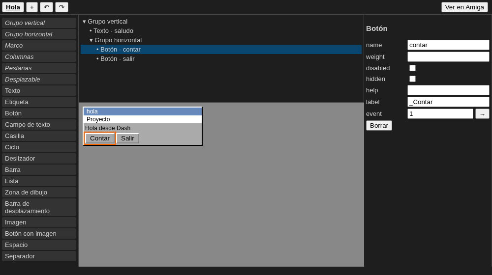
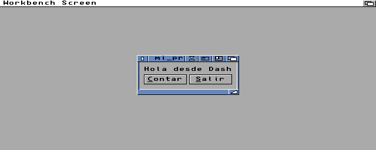

# Dash for VS Code

Support for [Dash](https://github.com/FreeMEM/dash), a language that compiles to C for the Amiga.

By **Francisco Antonio Tapias Bravo** ([FreeMEM](https://github.com/FreeMEM)).





**Video tutorial** (6 minutes, subtitles in Spanish): a first project, writing code, the window, compiling and
running, debugging, and debugging a real Amiga.

[](https://youtu.be/_UTJ_0s3xLc)

## Installing

1. Dash and the Amiga toolchain, as in the
   [quick installation](https://github.com/FreeMEM/dash#instalación-rápida) of the Dash repository (for the
   emulator, FS-UAE and a Kickstart ROM; for MUI windows, `tools/get_mui_sdk.sh` and `tools/emu_sys_mui.sh`).
2. This extension: `dash-mui-editor-0.2.1.vsix` from the [release](https://github.com/FreeMEM/dash/releases/tag/vscode-0.2.1), then in VS Code (1.86 or later)
   **Extensions: Install from VSIX...**, or `code --install-extension dash-mui-editor-0.2.1.vsix`.

## How it works with Dash

The extension is a thin layer: the work is done by the tools of the Dash repository (the folder of
`dash.path`), so updating Dash (`git pull`) updates what the extension knows of the language, without
reinstalling it.

| In VS Code | Done by |
|---|---|
| Errors while typing, completion, definition, rename, formatting | `compiler/lsp.py` |
| Compile | `./dash` |
| Run, memory check, profile | `./dash` and `tools/emu_run.py` (FS-UAE or Amiberry) |
| Visual editor and Ver en Amiga | `.dashui` (`compiler/dashui.py`) and `tools/emu_preview.py` |
| Debugging (F5) | `./dash --debug`, `tools/emu_run.py --gdbserver`, `m68k-amigaos-gdb` with `tools/gdb/dash.py`, `bgdbserver` |

## Getting started

1. You need VS Code 1.86 or later, the Dash repository (with `./dash` and `compiler/`), the Amiga toolchain
   (`m68k-amigaos-gcc` in `/opt/amiga`, or its folder in `DASH_TOOLCHAIN`) and, for the emulator, FS-UAE and a Kickstart ROM (settings `dash.emulator.*`). For MUI
   windows, the MUI SDK (`tools/get_mui_sdk.sh`) and Workbench files with MUI for the emulator
   (`tools/emu_sys_mui.sh`, setting `dash.emulator.muiSystem`). When something is missing, the extension says
   what, and how to get it.
2. **Dash: Nuevo proyecto** makes a folder with a program, its window (`ventana.dashui`) and a `launch.json`.
   If the folder is not inside the Dash repository, **Dash: Elegir la carpeta del compilador** (setting
   `dash.path`).
3. Open the window with the visual editor (**Ver en Amiga** shows it on the emulated Amiga), run the program
   (▶ in the status bar) and debug it with F5.

The walkthrough **Primeros pasos con Dash** (Help > Welcome, or "Welcome: Open Walkthrough") goes through the same.

## Features

- Syntax highlighting of `.dash` files (with the C of `@native` blocks): every keyword, directive and builtin,
  `Window` blocks, `#{...}` with expressions. Generated from the compiler (`tools/gen_tmgrammar.py` in the Dash
  repository; do not edit `syntaxes/dash.tmLanguage.json` by hand).
- **Errors while typing**: Dash's language server (`python3 -m compiler.lsp` in the compiler's folder, the
  same parser and analyzer as `./dash`) marks errors and warnings a moment after you stop typing, also those of
  imported modules in their files. Only in a trusted folder; `dash.languageServer.enabled`, `dash.python`, and
  **Dash: Reiniciar el servidor de lenguaje** (after changing `dash.path`).
- **Completion** (same server): every builtin with its parameters to fill in, keywords, the program's
  functions, structs, enums, constants and the variables seen at the cursor; after `x.` the fields and
  methods of its struct (or the values of an enum, the methods of a list...); types after `:` and `->`;
  files after `import "`. **Signature help** while writing the arguments of a call.
- **Navigation** (same server): hover (signature, type, description), go to definition (also into imported
  modules, into the window of a `.dashui`, and from an `import "..."` to its file), find references and the
  highlight of a name's uses (a local only inside its function).
- **Outline and symbols**: the outline and breadcrumbs of a file (structs with their fields and methods,
  enums with their values, functions, Main, windows, constants), symbols of the whole workspace (Ctrl+T), and
  **rename** (F2) of functions, structs, variables, fields... in every file of the program (not builtins, nor
  names that come from a `.dashui`: those are renamed in the visual editor; C inside `@native` is not changed).
- **Format document** (Shift+Alt+F): the indentation of every line by its blocks (also the trees of
  `mui_*_begin` ... `_end()` when they were indented), no spaces at the end; the C of `@native` untouched.
  **Quick fixes** (Ctrl+.) on "not defined": create the function (with as many parameters as the call),
  import it from the file of the workspace that has it, or "Cambiar a ..." a name that looks like it.
- Editing: snippets (`Main`, `func`, `struct`, `if`, `for`, `Window`, `mui`, `muiui`...), the `end` of a block
  added by itself when Enter opens one (setting `dash.editor.autoEnd`), `else`/`elif`/`end` back to their level,
  indentation, folding (also `# region` / `# endregion`), `#` comments, and an icon for `.dash` files.
- In a folder not trusted (Restricted Mode) only colours and the visual editor work; compiling, the emulator
  and the language server need a trusted folder.
- **Debugging (F5)**: breakpoints in the `.dash`, continue, step over/into/out, pause, the call stack and the
  variables, in Dash lines, on the emulated Amiga. F5 (or **Dash: Depurar en el Amiga**, or "Depurar" over
  `Main`) builds the program with `./dash --debug`, starts the emulator with it under `bgdbserver`
  (`tools/get_bgdbserver.sh` of the Dash repository, once) and attaches `m68k-amigaos-gdb -i=dap` to it (gdb is the
  debug adapter; `dash.debug.gdb`). The emulator stops with the session. `launch.json`: `program`, `stopOnEntry`,
  `machine`, `emulator`, `window`; `attach` with `target` (host:port of a bgdbserver) for a real Amiga.
  Step into (F11) goes only into the program's functions, not into the runtime's C.
  Values show as Dash writes them (texts, lists, dictionaries, structs with their fields, Fixed, Bool) and the
  runtime's frames and temporaries stay out of the stack and the variables (`tools/gdb/dash.py`).
  Expressions are Dash in the debug console, watch, hover, breakpoint conditions and logpoints (`p.x`, `l[i]`,
  `d["k"]`, `s.length`, `and`/`or`/`not`, `nil`, `Color.ROJO`): they are turned into C for gdb. In the debug
  console, `-exec <command>` sends a gdb command as it is. What the program prints (`Print`) comes out in the
  debug console as it runs, and an error of the program (an index out of a list, a memory error of
  `--memcheck`) stops it like an exception, at its line of Dash, with the error's text. Global variables read
  right: `tools/emu_run.py --gdbserver` puts `tools/gdb_relay.py` between gdb and bgdbserver (for a real Amiga,
  run it yourself: `tools/gdb_relay.py --listen 2345 --to amiga:2345 prog`).
- **Memory and profile**: a `--memcheck` run puts each memory error on the line where it happened (problem
  matcher `$dash-memcheck`); a `--profile` run opens its table (own and total time, calls) in a panel, each
  function a link to its code.
- **Emulator machine**: `dash.emulator.machine` (A1200 3.1, A500, A1200 3.2, 68040 with RTG) and
  `dash.emulator.program` (FS-UAE or Amiberry), also from the status bar (**Dash: Elegir la máquina del
  emulador**); per project in `.vscode/settings.json`. The program runs in the emulator's window
  (`dash.emulator.window`) and its output shows in the task's panel while it runs; stopping the task stops the
  emulator. MUI programs on the A1200 3.1 get `dash.emulator.muiSystem`.
- **Build and run** as VS Code tasks (type `dash`: `compile`, `run`, `memcheck`, `profile`; Terminal > Run Task,
  Ctrl+Shift+B, or in `tasks.json` with `"file": "${file}"`): **Dash: Compilar** (to `bin/` next to the file),
  **Dash: Ejecutar en emulador** (FS-UAE, `tools/emu_run.py`), **con comprobación de memoria** (`--memcheck`) and
  **con perfil** (`--profile`). Errors go through the `$dash` problem matcher (`file:line:column: Error: ...`) and
  `$gcc`, to Problems and onto the code. A CodeLens over `Main` (▶ Ejecutar · Compilar · Memoria · Perfil) and a
  ▶ Dash button in the status bar.

- **Visual editor for MUI windows** (`.dashui` files, format in `docs/MUI_EDITOR.md` of the Dash repository):
  palette, tree, properties, menus and an approximate preview. Drag from the palette or move objects in the
  tree or in the preview (before, after or into a group, by where you drop); a click or Enter on a palette
  button adds the object. Keys in the tree: arrows move the selection (left: its group, right: inside),
  Alt+Up/Down move the object, Delete removes it, F2 goes to its name, Enter to its properties, Ctrl+D
  duplicates; copy, cut and paste as usual (pasted names get a number if the window has them). Undo and redo as
  in any file (Ctrl+Z, Ctrl+Y, or the ↶ ↷ buttons). The tree and the palette are labelled for screen readers.
  Its problems (not valid JSON, unknown types, names that are not valid or repeated, event numbers that are not
  whole numbers above 0) are in the Problems panel at their line, while you edit it as text or in the editor.
  The **→** next to an event number goes to the code that handles it in a `.dash` that imports the file (a
  constant with that number, `const ID_ACEPTAR = 3`, and `if ev == ID_ACEPTAR`); if there is none, it offers to
  create it: the constant and an `if` in the loop of `mui_wait_event`.
  **Ver en Amiga** compiles a tiny program with the window, runs it in FS-UAE with MUI and shows a picture of
  the real thing. The emulated Amiga stays on between previews (`tools/emu_preview.py`, off after 10 minutes
  unused): the first one boots it (a few seconds more); after that a preview takes about 2.5 s on the A1200 and
  2 s on the 68040, and the same window again is not compiled again. On the machine of `dash.emulator.machine`
  (A1200 3.1, A1200 3.2 or 68040 with a graphics card; the A500 has no 68020 for MUI, so the A1200), with the
  Workbench files with MUI of `dash.emulator.muiSystem`, `muiSystem32` or `systemRtg`. A Dash program uses the file with `import "ventana.dashui"`.
  With **al cambiar** ticked next to the button (`dash.emulator.previewOnChange`), the picture comes again by itself
  a moment after each change; it goes off by itself if the emulator fails.
- **Dash: Nuevo fichero de ventanas MUI**: a new `.dashui` with one empty window.

## Debugging on a real Amiga

The Amiga needs a TCP/IP stack (Roadshow, AmiTCP, Miami...) and `bgdbserver` (Aminet `dev/debug/bgdbserver`;
`tools/get_bgdbserver.sh` of the Dash repository downloads it to `~/.cache/dash-debug/x/bgdbserver/`).

1. Open the `.dash` and run **Dash: Preparar para un Amiga real**: it builds `bin/<name>.debug` (`./dash --debug`).
2. Copy that file and `bgdbserver` to the Amiga, and in its Shell: `bgdbserver :2345 <name>.debug`
   (the port is yours; it must be below 32768). The program waits for the debugger.
3. In VS Code, a `launch.json` configuration "Dash: depurar en un Amiga real" (snippet), with `target` set to the
   Amiga's name or address and the port, and `program` to the `.dash`; then F5.

The breakpoints, steps, stack, variables and Dash expressions work as in the emulator. The extension puts
`tools/gdb_relay.py` between gdb and bgdbserver, so gdb finds the global variables (`"relay": false` goes
straight to `target`). What the program prints comes out in the Amiga's Shell (or in a file, with the DOS
variable `DASH_OUT`: `SetEnv DASH_OUT RAM:salida.txt`). Tried with the emulator standing in for the Amiga
(`tools/emu_run.py --gdbserver PORT --no-relay`), not on real hardware.

## Settings

- `dash.path`: folder of the Dash compiler (the one with `./dash`). Empty: looked for up from the file.
- `dash.emulator.kickstart`, `dash.emulator.system`: Kickstart ROM and Workbench files for FS-UAE
  (the same as `DASH_KICKSTART` and `DASH_EMU_SYS`); `kickstartA500`, `kickstart32`, `system32`, `systemRtg`
  for the other machines (`DASH_KICKSTART_A500`, `DASH_KICKSTART_32`, `DASH_EMU_SYS_32`, `DASH_EMU_SYS_32_RTG`).
- `dash.emulator.autoclose`: seconds after which a windowed program closes itself in the emulator.
- `dash.emulator.muiSystem`: Workbench files with MUI for "Ver en Amiga" (`DASH_EMU_SYS_MUI`, made with
  `tools/emu_sys_mui.sh`).
- `dash.emulator.previewOnChange`: "Ver en Amiga" again after each change in the visual editor ("al cambiar").

## Development

```
npm install        # only dev tools, in node_modules/
npm test           # grammar, model, preview and commands, without VS Code
python3 ../../tools/gen_tmgrammar.py   # after a change to the language or its builtins
DASH_PREVIEW_EMU=1 npm test   # also "Ver en Amiga" in FS-UAE (DASH_KICKSTART, DASH_EMU_SYS_MUI)
npm run build      # dist/extension.js (esbuild: the extension and vscode-languageclient in one file)
npm run test:vscode   # tests inside the installed VS Code (a window opens a few seconds; own profile and folder;
                      # the tests that type are skipped if that window does not get the desktop's focus)
npm run package    # dash-mui-editor-<version>.vsix (the bundle minified)
node test/screenshots.js   # images/editor.png and images/icon.png again (headless Chromium)
```

Install the package with `code --install-extension dash-mui-editor-<version>.vsix`. To publish it (not done yet):
the Visual Studio Marketplace needs the publisher `FreeMEM` made there and a personal access token of Azure DevOps
(`npx vsce publish --packagePath dash-mui-editor-<version>.vsix`); Open VSX (VSCodium, and other editors) needs
the namespace `FreeMEM` and its token (`npx ovsx publish dash-mui-editor-<version>.vsix -p <token>`). The
version and the `CHANGELOG.md` go up first.

## Author

Francisco Antonio Tapias Bravo ([FreeMEM](https://github.com/FreeMEM)), author of Dash and of this extension.
MIT License (`LICENSE`).

